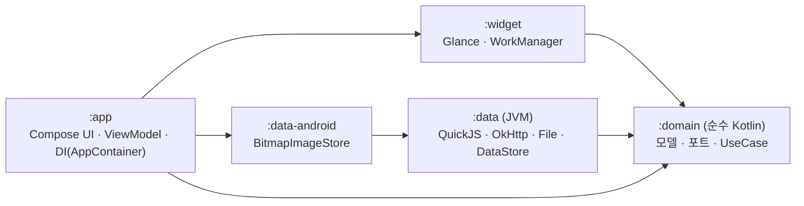
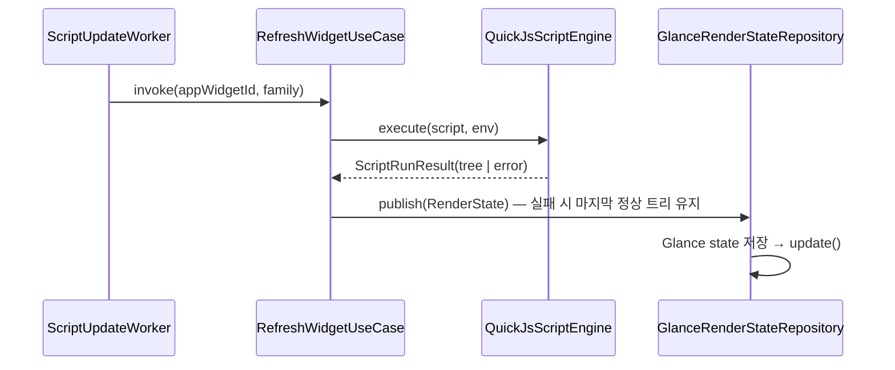

# ScriptWidget

[](https://github.com/b1ink301/ScriptWidget/actions/workflows/ci.yml)
[](https://github.com/b1ink301/ScriptWidget/releases)
[](LICENSE)

iOS [Scriptable](https://scriptable.app/)처럼 **JavaScript로 안드로이드 홈 화면 위젯을 만드는 앱**입니다. Scriptable 스크립트(`.js`, `.scriptable`)를 가져와 대부분 그대로 실행할 수 있습니다.

- 저장소: https://github.com/b1ink301/ScriptWidget · 라이선스: [GPL-3.0](LICENSE)
- 배포: GitHub 릴리스 (Google Play 아님 → [배포 정책과 권한](#배포-정책과-권한))
- JS 엔진: [QuickJS](https://github.com/dokar3/quickjs-kt) (`io.github.dokar3:quickjs-kt`) · 위젯: Jetpack Glance · 앱 UI: Jetpack Compose
- 백그라운드 갱신: 정확한 알람(`refreshAfterDate`, 없으면 15분 뒤 따라잡기) + WorkManager(60분 안전망). **화면이 꺼져 있으면 실행하지 않고 화면이 켜질 때 바로 갱신**(배터리 절약)

## 주요 기능

- **Scriptable 호환 API**: `ListWidget`·스택·텍스트·이미지·`DrawContext`·`Request`·`FileManager`·`Keychain`·`Location`·`Calendar`/`Reminder`/`Contact`·`Notification`·`Alert`/`UITable`/`WebView`·`Intl` 등 ([지원 JS API](#지원-js-api)). `scriptable://` 링크와 iOS 경로도 처리
- **갤러리**: 일정·할 일·달력·D-day·날씨·코인·RSS·세계 시계 등 23개 샘플, https `index.json` 카탈로그 추가(설치 전 코드·권한 확인), 업데이트 ([갤러리](#갤러리-샘플스크립트-마켓))
- **위젯**: small/medium/large, 위젯 파라미터, 탭·버튼 액션(Android 확장), 라이트/다크 색, 투명 배경
- **위젯 디자이너**: 코드 없이 텍스트·시각·심볼·이미지·스택을 배치하고 배터리·날씨·일정·할 일·JSON 등 데이터 블록을 연결. 미리보기는 실제 엔진으로 그리고, 저장하면 Scriptable 스크립트가 만들어짐 ([위젯 디자이너](#위젯-디자이너))
- **편집기**: 문법 색상, 자동완성, 찾기/바꾸기, 미리보기(크기별), 콘솔, 실행 기록, API 도움말
- **가져오기·내보내기**: `.js`/`.scriptable` 열기·공유, zip 전체 백업/복원, 파일 북마크(`bookmarkedPath`)
- **실행 경로**: 앱, 위젯, 공유 시트, 알림, 홈 화면 바로가기, 자동화 앱(Tasker 등) 브로드캐스트
- **한국어 · English**: 앱 화면, 갤러리, API 도움말, 디자이너 템플릿이 두 언어로 제공됩니다. 기기 언어를 따르고, Android 13 이상에서는 설정 탭에서 앱 언어를 따로 고를 수 있습니다 ([언어](#언어-한국어--english))
- **효율**: 위젯별 단일 실행, 오프라인 스킵, 최근 위치 재사용, HTTP 캐시, 캐시·임시 파일 정리

## 아키텍처 (Clean Architecture)



- **의존성은 안쪽(`:domain`)으로만** 향합니다. `:widget`은 `:domain`에만 의존하고, 구체적인 데이터 구현체는 `:app`의 `AppContainer`(Composition Root) 한 곳에서만 조립합니다.
- `:domain`과 `:data`는 **Android 의존성이 없는 JVM 모듈**입니다. quickjs-kt의 JVM 아티팩트에 macOS/Linux 네이티브가 포함되어 있어서, QuickJS 엔진과 `prelude.js`를 기기 없이 JVM 단위 테스트로 검증합니다. 앱에서 같은 의존성을 쓰면 Android 변형이 선택됩니다.
- `prelude.js`와 샘플 스크립트는 `:data`의 classpath 리소스입니다. 그래서 JVM 테스트와 APK가 같은 파일을 씁니다.

```
domain/        model(WidgetTree, WidgetFamily, RenderState…) · engine/ScriptEngine · repository/* · scheduler/* · usecase/*
               testFixtures/  Fake 리포지토리·엔진·스케줄러 (다른 모듈 테스트에서 재사용)
data/          engine/QuickJsScriptEngine, Prelude · http/OkHttpGateway · files/(SandboxedFileSystem, FileBookmarkStore)
               gallery/(BuiltinCatalogSource, RemoteCatalogSource, 설치 기록·카탈로그 URL 저장소) · history · backup · repository/*
               resources/prelude/*.js, resources/samples/(catalog.json, *.js)
data-android/  BitmapImageStore (BitmapFactory 다운샘플 + 실행 단위 캐시)
widget/        render/(GlanceRenderer, ScriptWidgetContent, Styles, ImageFileDecoder) · state/(GlanceRenderStateRepository, RenderStateCodec)
               work/(ScriptUpdateWorker, ScriptWorkerFactory, WorkManagerRefreshScheduler, WidgetFamilyResolver) · ScriptWidget, Receiver, RefreshAction
app/           di/AppContainer · ScriptWidgetApp(Configuration.Provider, WidgetDependencies.Provider)
               ui/list, ui/editor, ui/config, ui/gallery, ui/bookmarks, ui/history, ui/api, ui/permissions (ViewModel + stateless Screen)
               ui/preview · ui/scriptui · share · automation · deeplink · pin/WidgetPinner
```

### 실행 흐름



## 개발 방식: TDD

모든 기능은 **테스트를 먼저 작성하고(Red) → 구현해서 통과시키고(Green) → 정리(Refactor)** 하는 순서로 만들었습니다.

| 계층 | 테스트 종류 | 위치 | 개수 |
|---|---|---|---|
| domain | JVM 단위 테스트 (Fake 사용, 가져오기·내보내기, 백업·복원, 아이콘 헤더, 실행 기록, 자동화 실행, 파일 북마크, 갤러리 설치·업데이트·카탈로그 URL, 앱 업데이트 확인·버전 비교, 디자인 모델·편집 규칙·헤더·템플릿, 카탈로그 검사, 이벤트 트리거) | `domain/src/test` | 160 |
| data | JVM 단위 테스트: 실제 QuickJS·prelude 계약(API별), MockWebServer, 샌드박스, DataStore, SF→Material 매핑, 앱 UI·시스템·개인 데이터 브릿지, 리마인더 저장소, 샘플 스크립트, 실행 컨텍스트(config·args), 텍스트 스타일, API 목록, 실행 기록 파일, zip 백업, GitHub 릴리스 읽기, 디자이너 코드 생성(실제 QuickJS로 실행해 비교), 내장 카탈로그 검사, 트리거 저장소 | `data/src/test` | 270 |
| widget | JVM 단위 테스트 (RenderStateCodec, StackLayout(공간 나누기·10개 제한·제목 줄이기), 텍스트 렌더링 방식 판단, 가용 너비) | `widget/src/test` | 30 |
| app | JVM 단위 테스트 (ViewModel, 권한 화면·요청 흐름, 딥링크, 스크립트 UI 호스트, 문법 색상·자동완성·찾기, 공유 내용 분류, 아이콘, 파일 북마크, 갤러리, 탭 탐색 규칙, 목록 검색·활동, 업데이트 확인, 디자이너 편집·되돌리기·미리보기, 설치 전 권한 경고, 트리거 화면) | `app/src/test` | 133 |
| data-android | 기기 통합 테스트 (Bitmap, Keystore, LocationManager, Notification, Canvas, 심볼, Device, 클립보드·공유·메일·TTS 인텐트, CalendarProvider, ContactsProvider, MediaStore, 문서 읽기·쓰기, 알림 탭·버튼) | `data-android/src/androidTest` | 50 |
| widget | 기기 통합 테스트 (Glance 렌더링·그라데이션·테두리·버튼, 텍스트 비트맵, WorkManager, 정확한 알람, Worker, 위젯 액션, 이벤트 감시(콘텐츠 URI·조건·자정 알람)) | `widget/src/androidTest` | 65 |
| app | 기기 통합 테스트 (AppContainer + 실제 스택, 운영 DI 구성, 권한 상태, Compose 스크립트 UI, 공유·열기 인텐트, 공유 파일 복사, 자동화·바로가기, 앱 미리보기 배치, 갤러리, 플로팅 탭바·설정, 위젯을 세션 없이 한 번에 그리기, 업데이트 행, 디자이너 화면·새 스크립트 선택, 트리거 화면) | `app/src/androidTest` | 59 |
| **합계** | | | **767** (+ 호환성 측정 하네스 1, 기본 스킵) |

```bash
export JAVA_HOME="/Applications/Android Studio.app/Contents/jbr/Contents/Home"

# 단위 테스트 (기기 불필요)
./gradlew :domain:test :data:test :widget:testDebugUnitTest :app:testDebugUnitTest

# 통합 테스트 (에뮬레이터/기기 필요). 여러 기기가 연결되어 있으면 대상을 지정할 것
export ANDROID_SERIAL=emulator-5554
./gradlew :data-android:connectedDebugAndroidTest :widget:connectedDebugAndroidTest :app:connectedDebugAndroidTest
```

테스트로 잡은 버그:
- `prelude.js` 색상 알파값 hex가 소문자로 출력됨 (`#ff112233` → `#FF112233`)
- 이름을 바꾸면 위젯 바인딩이 옛 이름에 남아 있던 문제 (`RenameScriptUseCase`가 바인딩도 함께 이동)
- 위젯을 고정한 직후 바인딩이 저장되기 전에 주기 작업이 먼저 실행되어 에러 화면이 잠깐 보이던 문제 (`ScheduleBoundWidgetsUseCase`)
- 바인딩 시 `refreshNow`와 주기 작업의 첫 실행으로 스크립트가 두 번 실행되던 문제 (주기 작업 initialDelay 15분)
- Keychain 값이 `apply()`(비동기 저장)로 기록되어 짧게 끝나는 Worker에서 유실될 수 있던 문제 (`commit()`으로 변경)
- `Device` 정보에서 기본값이 있는 필드(`systemName`, `isPad`)가 JSON에서 빠지던 문제 (kotlinx.serialization `encodeDefaults`)
- `scriptwidget://`(앱 열기 링크)를 `java.net.URI`가 거부하던 문제
- 앱 시작 시 DI 순환으로 `StackOverflowError` 크래시: WorkManager의 on-demand 초기화가 Application에 worker factory를 요청하는데, factory가 스케줄러(=WorkManager)를 필요로 하는 UseCase를 즉시 만들고 있었음. 운영 구성을 그대로 검증하는 `ProductionWiringTest`로 재현 후 의존성을 지연 해석하도록 수정

## 설치

[Releases](https://github.com/b1ink301/ScriptWidget/releases)에서 APK를 받아 설치합니다. 대부분의 휴대폰은 `-arm64-v8a.apk`, 잘 모르겠으면 `-universal.apk`. 처음 설치할 때 "출처를 알 수 없는 앱" 설치를 허용해야 합니다. 업데이트는 같은 서명 키로 만든 새 APK를 덮어 설치하면 됩니다. **설정** 탭을 열면 최신 릴리스를 확인해 새 버전이 있으면 **새 버전 vX.Y.Z**를 보여 주고, 탭하면 이 기기에 맞는 APK를 받습니다(개발용 debug 빌드는 서명이 달라 덮어 설치할 수 없습니다).

## 화면 구성

화면 아래에 떠 있는 탭바로 이동합니다. 편집기·권한·파일 북마크 같은 화면은 탭바 없이 전체 화면으로 열리고, 뒤로 가기로 원래 탭에 돌아옵니다. 다른 탭에서 뒤로 가기를 누르면 **내 스크립트**로, 거기서 한 번 더 누르면 앱을 닫습니다.

| 탭 | 내용 |
|---|---|
| **내 스크립트** | 스크립트 목록·검색, 각 스크립트의 "위젯 n개 · n분 전 실행", 상단 **+ 새 스크립트**(코드로 작성 / 디자이너 템플릿), 스크립트 **⋮**(내보내기·바로가기·아이콘·삭제) |
| **갤러리** | 샘플·카탈로그 설치·열기·업데이트, **+ 카탈로그** |
| **기록** | 실행 기록 |
| **도움말** | API 도움말 |
| **설정** | 권한(자동화 앱 실행 포함), **화면이 꺼져 있어도 갱신**(기본 꺼짐), 파일 북마크, 가져오기, 전체 백업·복원, 카탈로그 관리, **앱 업데이트 확인**, 버전·GitHub·라이선스 |

## 빌드 & 실행

```bash
./gradlew :app:installDebug
```

1. 앱에서 스크립트를 열고 **▶ 실행** → "실행 결과" 탭에서 미리보기, 콘솔, 실행 시간 확인
2. **고정** 버튼으로 홈 화면에 위젯 추가 (또는 런처 위젯 목록 → ScriptWidget → Script)
3. 위젯을 탭하면 즉시 새로고침되고, `url`이 지정된 위젯/요소는 해당 URL이 열림
4. 스크립트를 저장하거나 이름을 바꾸면 그 스크립트를 쓰는 위젯이 모두 다시 실행됨

### 스크립트 가져오기 / 내보내기

- **가져오기**: **설정** 탭 → **스크립트 가져오기** → 시스템 파일 선택기에서 파일을 하나 이상 선택. 파일 앱·브라우저에서 `.js` 파일을 **ScriptWidget으로 열기**하거나 **공유**해도 가져옵니다.
  - `.js` `.txt`: 파일 이름(확장자 제외)이 스크립트 이름이 됩니다.
  - `.scriptable` (iOS Scriptable 내보내기 파일): 안의 `name`·`script`를 꺼내고, `icon`(색상·아이콘)은 스크립트 맨 위 아이콘 주석으로 저장합니다. 파일 앱에서 `.scriptable` 파일을 **열기**·**공유**해도 ScriptWidget이 후보로 나옵니다(형식이 `application/octet-stream`이라 다른 알 수 없는 파일에도 후보로 보일 수 있고, 스크립트가 아니면 거부합니다).
  - 같은 이름이 있으면 덮어쓰지 않고 `이름 2`, `이름 3`…으로 저장합니다. 파일 하나만 가져오면 바로 편집기가 열립니다.
  - 바이너리 파일, 빈 파일, 1MB 초과 파일은 거부하고 이유를 알려 줍니다.
- **내보내기**: 스크립트 옆 **⋮ → 내보내기** → 저장할 위치를 고르면 `이름.js`로 저장합니다.
- **전체 백업 / 복원**: **설정** 탭 → **전체 백업**은 모든 스크립트를 zip 하나로 저장합니다. **백업에서 복원**은 없는 스크립트를 추가하고, 같은 내용은 건너뛰고, 이름이 같고 내용이 다르면 `이름 2`로 추가합니다(덮어쓰지 않음).
- **아이콘·색상**: 스크립트 옆 **⋮ → 아이콘·색상**. Scriptable과 같은 방식(파일 맨 위 `// icon-color: …; icon-glyph: …;` 주석)으로 저장해서, Scriptable에서 가져온 스크립트의 아이콘도 그대로 보입니다.

### 갤러리 (샘플·스크립트 마켓)

**갤러리** 탭. 분류(일정·할 일 / 생활 / 정보 / 예제)별로 스크립트를 보고 **설치**·**열기**·**업데이트**합니다.

| 분류 | 기본 샘플 |
|---|---|
| 일정·할 일 | 오늘 일정(캘린더), 할 일(위젯에서 ○ 탭으로 완료, 앱에서 추가), 이번 달 달력, D-day(`2026-12-25 크리스마스`) |
| 생활 | 배터리, 메모(앱에서 편집), 습관 체크(`물 8`, + 버튼), 사진 액자(파일 북마크 `photo`), 다가오는 생일(연락처) |
| 정보 | 진행률(오늘·주·달·해), 코인 시세(업비트, 키 불필요), RSS 뉴스(기본 연합뉴스), 오늘의 명언, 세계 시계 |
| 예제 | 기존 샘플 9개(01_hello ~ 09_counter) |

- **기본 갤러리는 이 저장소의 [`samples/catalog.json`](data/src/main/resources/samples/catalog.json)을 읽습니다.** 그래서 샘플을 고치거나(항목의 `version`을 올림) 새 샘플을 추가해 `main`에 올리면, 앱을 다시 배포하지 않아도 갤러리에 **업데이트**·새 항목이 보입니다. 오프라인이거나 받기에 실패하면 앱에 들어 있는 사본을 씁니다.
- 처음 설치하면 갤러리 샘플이 모두 스크립트 목록에 들어갑니다(설치 기록도 함께 남아 나중에 업데이트 가능). 이미 스크립트가 있으면 아무것도 넣지 않습니다.
- 같은 이름이 있으면 덮어쓰지 않고 `이름 2`로 설치합니다. 갤러리 버전이 더 높으면 **업데이트**가 보이고, 설치 후 직접 고친 스크립트는 그대로 두고 새 버전을 `이름 2`로 설치합니다.
- **카탈로그 추가**(오른쪽 위 **+ 카탈로그**): https 주소의 `index.json`을 추가하면 그 목록도 갤러리에 나옵니다(예: GitHub 저장소의 raw 주소). 다른 곳에서 받은 스크립트는 설치 전에 **코드와 필요 권한을 보여 주고**, 확인한 그 코드 그대로 설치합니다. 불러오지 못한 카탈로그는 오류와 함께 표시되고, 삭제해도 설치한 스크립트는 남습니다.

`index.json` 형식 (`script`는 index.json 기준 상대 경로 또는 https 주소):
```json
{
  "title": "내 위젯 모음",
  "entries": [
    {
      "id": "clock", "name": "세계 시계", "title": "세계 시계", "category": "정보",
      "description": "여러 도시의 현재 시각", "script": "scripts/clock.js", "version": 2,
      "sizes": ["small", "medium"], "permissions": ["network"], "author": "me"
    }
  ]
}
```
`permissions` 값: `calendar` `contacts` `location` `network` `notification` `photos` (표시용). `version`을 올리면 설치한 사용자에게 업데이트가 보입니다.

- **샘플 기여·카탈로그 검사**: 방법은 [CONTRIBUTING.md](CONTRIBUTING.md)에 있습니다. CI가 내장 카탈로그를 검사합니다: 필드, 그리고 **코드가 쓰는 API와 `permissions`가 맞는지**. 자기 카탈로그는 `./gradlew :data:test --tests '*CatalogFileCheck*' -Pcatalog=/path/to/index.json`으로 확인할 수 있습니다.
- 원격 스크립트를 설치할 때, 카탈로그에 없는 권한을 코드가 쓰면 확인 창에 **⚠️ 경고**가 나옵니다.

### 위젯 디자이너

**+ 새 스크립트** → **디자이너로 만들기**에서 템플릿(빈 위젯·시계·배터리·다음 일정·할 일·날씨·JSON 값)을 고르면 디자이너가 열립니다.

- **화면**: 위쪽 미리보기(소·중·대), 아래 **구조**(요소 트리)와 **속성**(선택한 요소). 미리보기에서 요소를 탭해도 선택됩니다.
- **요소**: 텍스트, 시각(실시간), 심볼(SF Symbols 이름), 이미지(URL), 간격, 가로·세로 스택. 선택한 요소는 위·아래로 옮기기, 스택으로 묶기, 삭제. 되돌리기(↶)·다시 실행(↷).
- **데이터 블록**: 텍스트의 `{value}` 자리에 들어갈 값 — 날짜 문구(형식 지정), 배터리, 다음 일정(제목·시간), 할 일(남은 개수·가장 급한 것), 날씨(기온·상태, Open-Meteo), JSON 값(URL + `data.0.name` 같은 경로), 위젯 파라미터. 값을 못 가져오면 `–`를 보여 줍니다.
- **위젯 전체**: 배경색·그라데이션, 여백, 간격, 자동 갱신 요청(`refreshAfterDate`), 탭하면 열 주소.
- **미리보기 = 실제 위젯**: 바꿀 때마다 Scriptable 코드를 다시 만들어 실제 엔진으로 실행해 그립니다(데이터 블록도 실제 값).
- **저장 형식**: 일반 Scriptable 스크립트입니다. 맨 위 주석 `// scriptwidget-design: {...}`에 디자인이 함께 저장되어, 목록에서 열면 디자이너로 열립니다. **코드** 버튼으로 생성된 코드를 볼 수 있고, 편집기의 **디자인** 버튼으로 돌아옵니다.
- **코드를 직접 고치면**: 그 스크립트는 편집기로 열립니다. 디자이너로 다시 열면 경고가 나오고, 거기서 저장하면 코드가 디자인대로 다시 만들어집니다(직접 고친 부분은 사라짐).

### 스크립트를 실행하는 방법

| 방법 | 스크립트에서 보이는 값 |
|---|---|
| 편집기 **▶ 실행** | `config.runsInApp` |
| 홈 화면 위젯 (주기 갱신·탭·버튼) | `config.runsInWidget`, `args.widgetParameter`, `args.widgetAction` |
| `scriptwidget://run?scriptName=…&키=값` 링크 | `config.runsInApp`, `args.queryParameters` |
| 다른 앱의 **공유 → 스크립트로 실행** → 스크립트 선택 | `config.runsInActionExtension`, `args.plainTexts` `args.urls` `args.images` `args.fileURLs` (파일은 샌드박스 `tmp/share/`로 복사) |
| 스크립트가 예약한 알림을 탭 | `config.runsInNotification`, `args.notification` (`userInfo` 포함) |
| 홈 화면 바로가기 (**⋮ → 홈 화면에 바로가기**) | `config.runsFromHomeScreen` |
| 자동화 앱(Tasker·MacroDroid 등) | `config.runsFromAutomation`, `args.shortcutParameter` — 아래 참고 |
| **자동 실행 트리거** (설정 탭) | 캘린더·연락처 변경, 새 사진, 자정, 시간대 변경, 충전 중, Wi-Fi — `config.runsFromTrigger`, `args.trigger` — [아래 참고](#자동-실행-트리거) |

**자동화 앱 연동** (권한 화면에서 **자동화 앱에서 실행**을 켠 경우만):
- 실행: 브로드캐스트 `kr.b1ink.scriptwidget.action.RUN_SCRIPT`, extra `scriptName`(필수)·`parameter`(선택). 화면 없이 백그라운드에서 실행합니다(UI API는 에러).
- 결과: 끝나면 브로드캐스트 `kr.b1ink.scriptwidget.action.SCRIPT_RESULT`, extra `scriptName`·`output`(`Script.setShortcutOutput()` 값의 JSON)·`error`.
- 결과 브로드캐스트는 다른 앱도 받을 수 있으니 민감한 값은 `setShortcutOutput`으로 넘기지 마세요.

### 자동 실행 트리거

**설정 → 자동 실행 트리거 → + 트리거**: "언제 / 어떤 스크립트 / 무엇을"을 고릅니다.

| 언제 | 구현 (서비스를 계속 띄우지 않음) | `args.trigger` |
|---|---|---|
| 캘린더가 바뀌면 · 연락처가 바뀌면 · 새 사진이 생기면 | WorkManager 콘텐츠 URI 트리거 (여러 변경은 5초~1분 안에 한 번으로 묶음) | `calendar` `contacts` `photo` |
| 날짜가 바뀌면 (자정) | 화면을 깨우지 않는 알람 → 화면이 꺼져 있으면 다음에 켜질 때 | `day` |
| 시간대·시각이 바뀌면 | 시스템 브로드캐스트(`TIMEZONE_CHANGED`, `TIME_SET`) | `timezone` |
| 충전 중일 때 · Wi-Fi에 연결돼 있을 때 | WorkManager 조건, 실행 뒤 1시간 쉼 | `charging` `wifi` |

- **위젯 갱신**: 그 스크립트를 쓰는 위젯을 다시 그립니다. 최소 간격(5분)은 건너뛰지만, 화면이 꺼져 있으면 화면이 켜질 때 실행하고, 오프라인이면 건너뛰는 정책은 그대로입니다.
- **스크립트 실행**: 백그라운드에서 바로 실행합니다(기록 탭에 "트리거"로 남음). `config.runsFromTrigger`가 `true`이고, `args.trigger`로 어떤 이벤트인지 알 수 있습니다.
- 쓰지 않는 이벤트는 시스템에 등록하지 않습니다. 앱이 업데이트되거나 재부팅되면 다시 등록합니다.
- 에뮬레이터 확인: 사진 추가와 시간대 변경(서울→도쿄→서울) 때 스크립트가 "트리거"로 실행됐습니다.

### 언어 (한국어 · English)

- 기본 리소스는 영어(`values/`)이고 한국어는 `values-ko/`에 있습니다. 한국어 기기는 한국어, 그 밖의 언어는 영어로 나옵니다.
- **설정 → 앱 언어**(Android 13 이상): 기기 언어 / 한국어 / English. 시스템의 앱별 언어 설정에도 나타납니다(`locales_config.xml`).
- **갤러리**: `catalog.json` 항목의 `translations.en`(제목·설명·분류)과 `titles.en`을 씁니다. 온라인 카탈로그가 앱보다 오래되어 번역이 없으면, 앱에 들어 있는 사본의 번역을 빌려 씁니다. 자기 카탈로그에도 같은 필드를 넣을 수 있습니다.
- **디자이너**: 새 템플릿의 문구·날짜 형식과, 저장할 때 만들어지는 코드의 기본 문구(일정 없음/No events, 날씨 이름 등)가 앱 언어를 따릅니다.
- **위젯 오류**: "스크립트가 지정되지 않음" 같은 앱 자체 오류는 코드로 넘겨서 위젯을 그릴 때 앱 언어로 바꿉니다. 스크립트가 낸 오류는 그대로 보여 줍니다.
- 샘플 스크립트가 위젯에 그리는 글자(예: "오늘 일정")는 스크립트 내용이라 번역하지 않습니다.
- 기기 테스트는 앱 언어를 한국어로 고정하는 `KoreanLocaleTestRunner`로 돌리고, 영어 화면은 `EnglishUiTest`가 확인합니다.

### 편집기·실행 기록·도움말
- **편집기**: 줄 번호, 문법 색상(키워드·문자열·숫자·주석·API 이름), 키보드 위 자동완성(`Font.` 뒤에는 정적 멤버, `new ListWidget()`으로 만든 변수 뒤에는 그 클래스의 메서드, 그 밖에는 API·키워드·스크립트 안에서 선언한 이름), **찾기/바꾸기**(대소문자 무시, 모두 바꾸기).
- **실행 기록**: **기록** 탭. 앱·위젯·알림·공유·자동화 실행이 최근 200개까지 남습니다(시간, 실행 위치, 걸린 시간, 에러·로그). **실패만** 필터.
- **API 도움말**: **도움말** 탭 또는 편집기 **API** 버튼. 목록은 prelude를 QuickJS로 직접 조사해서 만들어서(생성자·메서드 인자·속성·async 여부) 구현과 항상 일치합니다. 각 항목에서 공식 문서로 이동할 수 있습니다.

## 지원 JS API

| API | 지원 |
|---|---|
| `ListWidget` | `addText` `addDate` `addImage` `addStack` `addSpacer` `backgroundColor` `backgroundGradient` `backgroundImage` `setPadding` `spacing` `url` `refreshAfterDate` `presentSmall/Medium/Large` |
| `WidgetStack` | 위 항목 + `layoutHorizontally/Vertically` `top/center/bottomAlignContent` `cornerRadius` `size` `borderColor` `borderWidth` |
| `WidgetText` | `textColor` `font` `textOpacity` `lineLimit` `left/center/rightAlignText` `url` `shadowColor` `shadowRadius` `shadowOffset` `minimumScaleFactor` |
| `WidgetDate` | `applyTimeStyle/DateStyle/RelativeStyle/TimerStyle` |
| `WidgetImage` | `imageSize` `cornerRadius` `url` `tintColor` `left/center/rightAlignImage` `applyFitting/FillingContentMode` (`resizable` `containerRelativeShape`는 무시) |
| `LinearGradient` | `colors` `locations` `startPoint` `endPoint` |
| `SFSymbol` | `named()` `image` `applyFont` `apply*Weight` — **Material Icons로 대체** (SF 이름 340개 직접 매핑 + `.fill`·`.circle` 등 변형은 기본형으로 대체, 없으면 placeholder + 경고) |
| `DrawContext` `Path` `Rect` | 색·선·폰트·정렬 설정, `fill/strokeRect` `fill/strokeEllipse` `addPath` `fill/strokePath` `drawText(InRect)` `drawImage*` `getImage` / `move` `addLine` `addQuadCurve` `addCurve` `addRect` `addRoundedRect` `addEllipse` `addLines` `addRects` `closeSubpath` / `Rect`의 `min/mid/maxX·Y` `origin` `size` |
| `Device` | `name` `systemName` `systemVersion` `model` `isPhone/isPad` `screenSize/Resolution/Scale/Brightness` 방향 `batteryLevel` `isCharging` `isFullyCharged` `preferredLanguages` `locale` `language` `isUsingDarkAppearance` `volume` |
| `UUID` `Timer` | `UUID.string()`, `Timer.schedule` / `new Timer()` `timeInterval` `repeats` `invalidate` |
| `RelativeDateTimeFormatter` | `string(date, ref)` named/numeric 스타일 (영어·한국어) |
| `XMLParser` | SAX 스타일 콜백 (`didStartElement` `foundCharacters` `didEndElement` `parseErrorOccurred` …), DTD·외부 엔티티 비활성 |
| `Safari` `URLScheme` | `open` `openInApp`(위젯 갱신 중엔 불가) / `forRunningScript` `forOpeningScript` `forOpeningScriptSettings` `forOpeningApp` `parameter` `allParameters` — `scriptwidget://run?scriptName=…` 딥링크를 앱이 처리 |
| `Request` | `url` `method` `headers` `body` `timeoutInterval` `load` `loadString` `loadJSON` `loadImage` `response` |
| `FileManager` | `local()` `iCloud()`(=local) `documents/cache/temporaryDirectory` `joinPath` `read/write` `readString/writeString` `readImage/writeImage` `fileExists` `isDirectory` `createDirectory` `listContents` `remove` `fileName` `fileExtension` `modificationDate` `fileSize` — 앱 전용 샌드박스 밖 경로는 거부 · 파일 북마크 `bookmarkedPath` `bookmarkExists` `allFileBookmarks` (**설정** 탭 → **파일 북마크**에서 이름을 정하고 파일을 고르면 앱 안으로 복사됨) |
| `Keychain` | `set` `get`(없으면 throw) `contains` `remove` — Android Keystore AES-GCM으로 암호화 |
| `Location` | `current()` `setAccuracyTo*()` `reverseGeocode()` — 실패 시 마지막 위치(권한이 있을 때만) |
| `importModule` | 다른 스크립트를 CommonJS 모듈로 (`module.exports`, 캐시, 순환 참조) |
| `Data` | `fromString` `fromBase64String` `fromBytes` `fromFile` `fromPNG/JPEG` `toRawString` `toBase64String` `getBytes` |
| `Image` | `Image.fromData` `Image.fromFile` |
| `Notification` | `title` `subtitle` `body` `openURL` `threadIdentifier` `userInfo` `scriptName` `addAction` `setTriggerDate` `schedule` `remove` `removePending/Delivered` `allPending` `allDelivered` `current` `resetCurrent` — 탭하면 `scriptName` 스크립트가 `args.notification`과 함께 실행 |
| `Intl` (일부) | `Intl.NumberFormat`(decimal/percent/currency, 소수 자릿수, 그룹핑), `Intl.DateTimeFormat`(dateStyle/timeStyle/timeZone, weekday·year·month·day·hour·minute·second·hour12 — 한국어·중국어·일본어·영어 순서, `new` 없이 호출, `resolvedOptions()`), `toLocaleString/DateString/TimeString` |
| `DateFormatter` | `dateFormat` 패턴 `string()` `date()` `locale` `use*DateStyle/TimeStyle` |
| `Color` `Font` `Size` `Point` | `new Color(hex, alpha)`, 기본 색상, `Font.*SystemFont(size)` 등 |
| `Alert` | `title` `message` `addAction` `addDestructiveAction` `addCancelAction` `addTextField` `addSecureTextField` `textFieldValue` `present` `presentAlert` `presentSheet` |
| `UITable` `UITableRow` `UITableCell` | `addRow` `removeRow` `removeAllRows` `reload` `present` `showSeparators` / `height` `isHeader` `dismissOnSelect` `onSelect` `backgroundColor` / `text` `image` `imageAtURL` `button`(`onTap`) 정렬·폰트·색. 표 안에서 다른 표를 띄우는 중첩 표 지원, 스크립트가 에러로 끝나면 표를 자동으로 닫음 |
| `DatePicker` `QuickLook` | `pickDate` `pickTime` `pickDateAndTime` `pickCountdownDuration` `minimumDate` `maximumDate` `initialDate` / `present`(텍스트·이미지·JSON) |
| `WebView` | `loadURL` `loadRequest` `loadHTML` `loadFile` `evaluateJavaScript`(`completion` 콜백 포함) `getHTML` `present` `waitForLoad` `shouldAllowRequest` 정적 `loadURL/HTML/File` |
| `DocumentPicker` | `open` `openFile` `openFolder` `export` `exportString` `exportImage` `exportData` — 시스템 파일 선택기(SAF) 사용, 고른 파일은 샌드박스로 복사 |
| `Pasteboard` `ShareSheet` | `copy(String)` `paste(String)` `pasteImage` / `present`(문자열·URL·이미지·Data) |
| `Mail` `Message` | `toRecipients` `cc/bccRecipients` `subject` `body` `isBodyHTML` 첨부 `send` / `recipients` `body` `send` — 메일·문자 앱 작성 화면을 띄움 |
| `CallbackURL` | `addParameter` `getURL` `open` — x-callback-url, 다른 앱이 `scriptwidget://x-callback-url/success…`로 응답 |
| `Speech` `Dictation` | `speak`(TTS) / `start(locale)`(음성 인식) |
| `Calendar` `CalendarEvent` `RecurrenceRule` | 캘린더 목록·기본 캘린더·`forEvents*` / `today` `tomorrow` `yesterday` `thisWeek` `nextWeek` `lastWeek` `between` `save` `remove` `presentEdit` `presentCreate` / 일·주·월·년 반복 규칙(RRULE) |
| `Reminder` | `all*` `allDue*` `allIncomplete*` `completed*` `incompleteDue*` `scheduled` `between` `save` `remove`, 리스트 `forReminders*` `createForReminders` |
| `Contact` `ContactsContainer` `ContactsGroup` | `all` `inGroups` `add` `update` `delete` `persistChanges` `image` / `all` `default` `withIdentifier` / `all` `addMember` `removeMember` |
| `Photos` | `latestPhoto(s)` `latestScreenshot(s)` `fromLibrary` `fromCamera` `save` |
| `Script` `config` `args` | `setWidget` `complete` `setShortcutOutput`, `runsInWidget` `runsInApp` `runsInActionExtension` `runsInNotification` `runsFromHomeScreen` `runsFromAutomation` `runsFromTrigger`(Android 확장) `widgetFamily`, `args.widgetParameter` `args.widgetAction` `args.queryParameters` `args.plainTexts` `args.urls` `args.fileURLs` `args.images` `args.all` `args.notification` `args.shortcutParameter` `args.trigger`(Android 확장) |
| 위젯 버튼 (Android 확장) | 요소의 `tapAction = "이름"` 또는 `widget.addButton(title, action)` — 탭하면 앱을 열지 않고 스크립트를 다시 실행하고, 스크립트는 `args.widgetAction`으로 어떤 버튼인지 알 수 있음 |
| 전역 | `console.*` `log` `setTimeout` `clearTimeout` `sleep(ms)` |

`prelude.js`는 `data/src/main/resources/prelude/` 아래 기능별 파일로 나뉘어 있고, `index.txt` 순서대로 합쳐집니다.

### 동작 메모
- **refreshAfterDate**: 지정 시각에 1회 갱신을 예약하고, 그 전의 **주기 갱신은 건너뜀**. 스크립트가 정하지 않으면 마지막 실행 15분 뒤로 "따라잡기" 갱신을 예약. 탭·편집·바인딩 같은 수동 갱신은 항상 즉시 실행.
- **Location (위젯)**: 위젯은 백그라운드에서 실행됨. **백그라운드 위치(항상 허용)**를 허용하면 위젯도 현재 위치를 쓰고, 허용하지 않으면 앱에서 실행했을 때 얻은 **마지막 위치**를 씀 (백그라운드 권한 없이는 `lastKnown`도 null). 스크립트는 `timestamp`로 오래된 위치인지 판단 가능.
- **백그라운드 갱신 정책 (배터리)**:

  | 상황 | 동작 |
  |---|---|
  | 화면 켜짐 | 요청 시각에 갱신하되 마지막 실행 후 **최소 5분**. 알람은 폰을 깨우지 않는 `RTC` |
  | 화면 꺼짐 (기본) | 예약·주기 갱신을 **실행하지 않음**. 밀린 갱신은 깨우지 않는 알람으로 기다렸다가 **화면이 켜지면(잠금 화면 포함) 바로 실행** — 잠금을 풀고 홈 화면이 보일 때쯤에는 갱신돼 있음 |
  | 화면 꺼짐 + 설정 탭 **"화면이 꺼져 있어도 갱신"** 켬 | 최소 **15분** 간격으로 폰을 깨워(`RTC_WAKEUP`) 갱신. 백그라운드에서 알림을 예약하거나 기록을 남기는 스크립트용 |
  | 수동 (탭·버튼·편집·위젯 설정) | 화면 상태와 관계없이 즉시 |

  - 스크립트가 `refreshAfterDate`를 정하지 않은 위젯도 마지막 실행 15분 뒤 "따라잡기" 알람을 걸어, 화면이 켜지면 갱신됩니다.
  - 화면이 꺼진 채 폰이 잠깐 깨어나 알람이 울려도(푸시 알림 등) 실행하지 않고 2분 뒤로 다시 미룹니다(깨우지 않는 알람이라 추가 배터리 비용 없음).
  - WorkManager 주기 작업은 재부팅 등으로 알람이 사라졌을 때를 위한 **60분 안전망**이고, 화면이 꺼져 있으면 바로 끝납니다. 깨우지 않는 알람에는 WorkManager 예약을 함께 걸지 않습니다(작업이 화면 꺼짐 중에 폰을 깨울 수 있어서).
  - 안드로이드 자체 제한(Doze, 삼성 "앱 절전")은 이와 별개로 갱신을 더 늦출 수 있습니다. 설정 탭 → 권한에서 **배터리 최적화 제외**를 권장합니다.
- **중복 실행 방지**: 같은 위젯은 한 번에 하나만 실행하고, 방금 갱신된 위젯의 예약·주기 갱신은 건너뜀. 위젯 크기를 바꿔도 크기 구분(small/medium/large)이 같으면 다시 그리기만 하고 스크립트는 실행하지 않음.
- **오프라인**: 네트워크가 없을 때 `Request`·`WebView`·`importModule`을 쓰는 스크립트의 백그라운드 갱신은 건너뛰고 마지막 화면을 유지. 응답은 10MB까지, HTTP 캐시(10MB)는 서버의 캐시 헤더를 따름.
- **위치**: 요청 정확도에 맞는 최근 위치(정밀 1분, 100m 5분, 1~3km 15분 이내)는 GPS를 다시 켜지 않고 재사용. 새로 잡을 때도 전체 15초 안에서만 시도.
- **저장공간·메모리**: 위젯을 지우면 그 위젯의 이미지 캐시도 삭제, `tmp`(공유받은 파일·카메라 사진·고른 문서)는 하루 지나면 정리. 불투명한 이미지는 JPEG, 투명한 이미지는 PNG로 저장. 이미지가 많은 위젯은 전체 비트맵 용량(6MB) 안에서 이미지를 작게 디코딩하고, 긴 텍스트 이미지는 높이 2048px까지. 실행 기록은 한 줄씩 추가(JSONL)하고 400줄이 되면 200줄로 정리.
- **refreshAfterDate 정확도**: `USE_EXACT_ALARM`으로 지정 시각에 정확히 실행(화면이 켜져 있을 때). 재부팅 등으로 알람이 사라지면 60분 안전망 작업이 다시 실행해 알람을 새로 겁니다. 정확한 알람을 쓸 수 없는 기기는 WorkManager 예약으로 대신합니다.
- **권한 요청**: 편집기에서 실행할 때 스크립트가 `Location.` / `Notification(` / `CalendarEvent.` / `Contact.` / `Photos.latest…`를 쓰면 필요한 권한만 먼저 요청.
- **앱 UI (Alert·UITable·WebView 등)**: 앱에서 실행할 때만 사용 가능. 위젯 갱신 중에 부르면 "…during a widget refresh" 에러. 사용자가 화면을 보고 있는 시간은 실행 타임아웃에 포함하지 않음 (앱 실행은 전체 30분 상한).
- **위젯 버튼**: 탭은 위젯마다 순서대로 처리되어(연속 탭이 누락되지 않음) 카운터 같은 상태 위젯을 만들 수 있음. 상태는 `FileManager`나 `Keychain`에 저장.
- **Reminder**: Android에는 시스템 미리 알림 앱이 없어 **앱 안의 JSON 파일**(`filesDir/reminders/`)에 저장. 마감 시각이 있고 미완료면 그 시각에 알림을 예약 (알림 권한이 없으면 알림만 생략하고 저장은 됨).
- **Calendar**: 쓸 수 있는 캘린더가 없으면 "ScriptWidget" 로컬 캘린더를 만들어 사용. `Calendar.presentPicker()`는 미지원.
- **Contacts**: 계정이 컨테이너. 계정 없이 저장된 연락처는 "local" 컨테이너. 변경은 `persistChanges()` 때 한 번에 적용.
- **Photos**: 저장한 사진은 `Pictures/ScriptWidget/`에 들어감. 선택(`fromLibrary`)은 시스템 사진 선택기를 써서 권한이 필요 없음. `removeLatest*`·`Pasteboard.copyImage`는 미지원.
- **SFSymbol**: Android에 SF Symbols가 없어 Material Icons 폰트(Apache-2.0, 약 350KB)로 그림. 아이콘 모양은 다를 수 있음.
- **테두리 (Glance)**: Glance에 테두리 기능이 없음. 스택에 단색 배경이 있으면 정확히 그리고, 없으면 외곽선 비트맵을 늘려 깔아서 근사 (선 두께가 스택 비율에 따라 조금 달라짐).
- **유연한 Spacer가 있는 스택**: Scriptable처럼 해당 축으로 늘어나도록 렌더러가 처리 (RemoteViews는 기본적으로 내용 크기만 차지).
- **iOS Scriptable 호환**: `scriptable:///run/<이름>`·`scriptable:///run?scriptName=` 링크도 `scriptwidget://`처럼 처리합니다(iOS용 스크립트의 `Safari.open`·위젯 `url`). 스크립트에 박힌 iOS 경로(`/var/mobile/Library/Mobile Documents/iCloud~dk~simonbs~Scriptable/Documents/…`, 앱의 `Documents`·`Library/Caches`)는 샌드박스의 같은 폴더로 바꿔 줍니다. `new Color("default")`처럼 잘못된 색 문자열은 에러 대신 검은색입니다(Scriptable과 같음).
- **열 안의 정렬**: 가운데·오른쪽 정렬은 열이 가로를 다 차지할 때만 전체 너비로 펼쳐서 맞춥니다. 내용 크기만큼인 열(SwiftUI VStack)에서 펼치면 가로줄의 남는 공간을 빼앗기 때문입니다.
- **늘어나는 스택의 전파**: SwiftUI처럼 Spacer로 늘어나려는 자식이 있으면 부모 스택도 그 방향(가로·세로)으로 늘어나고, 같은 행/열의 늘어나는 형제들은 공간을 똑같이 나눕니다 (예: Sub Calendar의 2×2 카드 격자).
- **`Color.dynamic(밝은색, 어두운색)`**: 두 색을 모두 위젯에 넘겨서, 시스템 라이트/다크 모드가 바뀌면 스크립트를 다시 실행하지 않아도 바로 바뀝니다.
- **가로 스택의 공간 나누기**: SwiftUI처럼 늘어나려는 자식들(예: 행마다 Spacer가 있는 왼쪽·오른쪽 열)이 너비를 똑같이 나눕니다. `[순위, 제목(lineLimit 1), Spacer, 언론사]` 같은 행은 제목이 남는 공간을 차지하고 말줄임으로 줄어들어 뒤 요소가 밀려나지 않습니다.
- **자식 10개 제한**: RemoteViews는 한 행/열에 자식을 10개까지만 그리고 나머지를 버립니다. 렌더러가 넘치는 자식을 안쪽 컨테이너로 묶어 모두 그립니다 (`spacing`으로 생기는 간격도 개수에 포함).
- **텍스트 렌더링**: Glance로 그릴 수 없는 텍스트는 비트맵으로 그립니다: 3단계(regular/medium/bold) 밖의 굵기, 그림자, `minimumScaleFactor`(최소 배율까지 줄여도 넘치면 말줄임), `Documents/fonts/<이름>.ttf|otf`에 넣은 글꼴(`new Font("이름", 크기)`). `Menlo`·`Courier` 같은 이름은 고정폭, `Georgia`·`Times` 계열은 세리프 시스템 글꼴로 대체.
- **Intl**: QuickJS에 없어서 `java.text`/`java.time`으로 구현. `year`/`month` 같은 개별 구성요소 옵션은 미지원. 출력은 JVM(CLDR)과 Android(ICU)가 조금 다를 수 있음.

## Scriptable 호환성 측정

커뮤니티 위젯 스크립트를 실행해서, 위젯을 에러 없이 그리는 비율을 측정합니다. 스크립트는 저장소에 포함하지 않습니다.

```bash
./gradlew :data:test --tests '*CompatibilityReport*' -PcompatCorpus=/path/to/scripts
cat data/build/compat-report.txt
```

- 네트워크 응답은 하네스에서 "어떤 속성에 접근해도 진행되는 Proxy"로 대체합니다. 그래서 데이터 형태가 아니라 API 누락을 측정합니다.
- `<corpus>/_docs/<스크립트 이름>/`이 있으면 그 내용을 Documents 폴더에 넣고 실행합니다. 저장소 전체를 Scriptable에 받아 둔 사용자와 같은 상태(모듈·설정 파일)로 측정하기 위해서입니다.

**측정 대상**: [awesome-scriptable](https://github.com/dersvenhesse/awesome-scriptable)에 등록된 스크립트 33개에, 2026-10-30에 GitHub의 Scriptable 위젯 저장소 71곳에서 모은 143개(`ListWidget`을 쓰는 파일, 저장소당 최대 4개, 중복 제거)를 더해 **176개**입니다.

| 시점 | 대상 | 에러 없이 위젯을 그린 스크립트 |
|---|---|---|
| Track A 완료 후 | 33개 | 12 (36%) |
| API 보강 후 (WidgetImage·SFSymbol·DrawContext·Device 등) | 33개 | 21 (64%) |
| 앱 UI·WebView·시스템 연동·개인 데이터 구현 후 | 33개 | 23 (70%) |
| 측정 대상 확대 (2026-10-30) | 176개 | 80 (45%) |
| `module` 전역·`arguments`·`atob`/`btoa`·Documents 모듈 + 저장소 파일 제공 | 176개 | **101 (57%)** |

측정 대상을 넓히면서 찾아 보강한 것:
- **`module` 전역**: Scriptable은 모든 스크립트에 `module.filename`·`module.exports`를 줍니다. iCloud 사용 여부를 확인하거나 모듈 경로를 계산하는 데 씁니다(13개).
- **최상위 `arguments`**: 스크립트를 함수 안에서 실행하므로 Scriptable처럼 존재합니다.
- **`atob` / `btoa`**
- **`importModule`이 Documents 폴더도 찾음**: 하위 폴더 경로나 Documents 안의 절대 경로로 부를 수 있고, 스크립트가 내려받아 저장한 모듈도 불러옵니다.

남은 75개 실패는 API 누락이 아닙니다.

| 원인 | 개수 |
|---|---|
| 하네스의 가짜 응답 형태 때문에 멈춤 (실제 API 응답 필요) | 35 |
| 위젯 파라미터·API 키·북마크 설정이 필요 | 14 |
| 처음에 앱에서 실행해 설정해야 함 (위젯에서는 `Alert`를 띄울 수 없음, Scriptable도 같음) | 5 |
| 스크립트 자체 버그 (정의되지 않은 변수, `ListWidget.centerAlignContent` 같은 없는 API 호출 등) | 7 |
| 저장소에 없는 모듈·파일이 필요 | 4 |
| 기타 (앱 전용 스크립트, 오프라인 처리 등) | 10 |

[docs.scriptable.app](https://docs.scriptable.app/)의 API 60개를 모두 구현했습니다. iOS에만 있는 일부 기능(`Calendar.presentPicker`, `Photos.removeLatest*`, `Pasteboard.copyImage`)은 호출하면 명확한 에러를 냅니다.

## 배포 정책과 권한

ScriptWidget은 **Google Play가 아니라 GitHub로 배포**합니다. 그래서 Play 정책 때문에 쓰기 어려운 권한도 사용합니다. 사용자는 앱의 **권한** 화면(**설정** 탭 → 권한)에서 각 권한의 상태와 용도를 보고 허용할 수 있습니다. 위젯에 중요한 권한이 빠져 있으면 목록 화면에 배너가 뜹니다.

| 권한 | 용도 | 요청 방식 | Play 배포였다면 |
|---|---|---|---|
| `POST_NOTIFICATIONS` | `Notification` | 시스템 대화상자 (Android 13+) | 가능 |
| `ACCESS_FINE/COARSE_LOCATION` | `Location` | 시스템 대화상자 | 가능 |
| `ACCESS_BACKGROUND_LOCATION` | 위젯 갱신 중 현재 위치 | 위치 허용 후 시스템 설정의 "항상 허용" | 심사 필요, 사실상 어려움 |
| `REQUEST_IGNORE_BATTERY_OPTIMIZATIONS` | 절전 상태에서도 위젯 갱신 | 시스템 대화상자 | 정책상 제한 |
| `USE_EXACT_ALARM` (+ API 31–32는 `SCHEDULE_EXACT_ALARM`) | `refreshAfterDate` 정시 갱신 | 설치 시 자동 허용 | 알람·캘린더 앱만 허용 |
| `READ/WRITE_CALENDAR` | `Calendar` `CalendarEvent` | 시스템 대화상자 | 가능 (용도 설명 필요) |
| `READ/WRITE_CONTACTS` | `Contact` `ContactsContainer` `ContactsGroup` | 시스템 대화상자 | 가능 (용도 설명 필요) |
| `READ_MEDIA_IMAGES` (API 32 이하는 `READ_EXTERNAL_STORAGE`) | `Photos.latest*` | 시스템 대화상자 | 핵심 기능일 때만 허용 |

- 편집기에서 스크립트를 실행할 때 위 API를 쓰면 필요한 권한을 그때 요청합니다.
- 시스템이 더 이상 권한을 묻지 않는 경우(두 번 거부)에는 앱 설정 화면으로 안내합니다.
- `Reminder`, `Photos.fromLibrary/fromCamera/save`, `DocumentPicker`, `Pasteboard`, `Mail`/`Message`(작성 화면만 띄움)는 권한이 필요 없습니다. 카메라는 시스템 카메라 앱을 쓰므로 `CAMERA` 권한을 선언하지 않습니다.

## 릴리스 서명

`app/build.gradle.kts`는 서명 정보를 아래 순서로 찾습니다. 둘 다 없으면 release APK는 서명되지 않습니다. release 빌드에는 R8(코드 축소·난독화)이 켜져 있습니다.

1. `../keystore/scriptwidget.properties` (저장소 밖, 다른 앱들의 키 파일과 같은 위치)
2. 환경변수 `SCRIPTWIDGET_KEYSTORE_FILE` `SCRIPTWIDGET_KEYSTORE_PASSWORD` `SCRIPTWIDGET_KEY_ALIAS` `SCRIPTWIDGET_KEY_PASSWORD` (CI용)

### 키 만들기 (한 번만)

```bash
cd ../keystore
keytool -genkeypair -v -keystore scriptwidget-release.jks -alias scriptwidget \
  -keyalg RSA -keysize 4096 -validity 36500 \
  -dname "CN=<이름>, O=<조직 또는 개인>, C=KR"
# 비밀번호는 프롬프트에서 입력 (명령줄 기록에 남지 않게)
```

`../keystore/scriptwidget.properties`:

```properties
storeFile=scriptwidget-release.jks
storePassword=<키스토어 비밀번호>
keyAlias=scriptwidget
keyPassword=<키 비밀번호>
```

```bash
./gradlew :app:assembleRelease                      # app/build/outputs/apk/release/app-<abi>-release.apk (ABI별 + universal)
./gradlew :app:signingReport                        # 등록에 쓸 SHA-256 지문 확인
apksigner verify --print-certs app/build/outputs/apk/release/app-universal-release.apk
```

### CI/CD (GitHub Actions)

| 워크플로 | 언제 | 하는 일 |
|---|---|---|
| [`ci.yml`](.github/workflows/ci.yml) | `main`·`develop` 푸시, PR, 수동 | **테스트**: 단위 테스트(domain·data(QuickJS)·widget·app) → 디버그 APK(아티팩트) → 에뮬레이터(API 35)에서 기기 테스트<br>**검사**(동시에): 코드 스타일(ktlint) → Android Lint → R8 release 빌드(서명 없이)<br>실패한 테스트·검사는 이름과 메시지가 GitHub 주석으로 남습니다 |
| [`release.yml`](.github/workflows/release.yml) | `v*` 태그 푸시 | 단위 테스트 → 서명된 release APK(arm64-v8a·armeabi-v7a·x86_64·universal) → 서명 검증·SHA-256 → GitHub 릴리스 생성 |

| [`dependabot.yml`](.github/dependabot.yml) | 매주 월요일 | Gradle 의존성·GitHub 액션 업데이트를 묶어서 `develop`으로 PR |

**코드 스타일·Lint**
- `./gradlew spotlessCheck`로 검사하고 `./gradlew spotlessApply`로 고칩니다. 규칙은 IntelliJ 스타일 ktlint이고, 기존 코드의 한 줄 서명·식 본문·호출 체인을 바꾸는 줄 바꿈 규칙은 껐습니다(`build.gradle.kts`의 `ktlintRules`).
- Android Lint는 모듈별 `lint-baseline.xml`에 기존 경고를 기록해 두고, **새로 생긴 오류만** 실패로 처리합니다. 기준선을 다시 만들려면 `./gradlew updateLintBaseline`을 실행합니다. Lint를 처음 붙이면서 찾은 Android 12 이하 딥링크 크래시(API 33 전용 `URLDecoder.decode`)는 고쳤습니다.
- detekt는 아직 Kotlin 2.4를 지원하는 안정판이 없어(1.23.8은 미지원, 2.0은 알파) 넣지 않았습니다.

릴리스 만들기:
```bash
git tag v0.2.0 && git push origin v0.2.0      # versionName 0.2.0, versionCode 200 (major*10000+minor*100+patch)
```
`-beta.1`처럼 `-`가 붙은 태그는 사전 릴리스로 올라갑니다.

릴리스 워크플로는 저장소 **Settings → Secrets and variables → Actions**의 아래 비밀 값으로 서명합니다(없으면 실패하고 이유를 알려 줌):

| Secret | 값 |
|---|---|
| `SCRIPTWIDGET_KEYSTORE_BASE64` | `base64 -i ../keystore/scriptwidget-release.jks \| pbcopy` 결과 |
| `SCRIPTWIDGET_KEYSTORE_PASSWORD` | 키스토어 비밀번호 |
| `SCRIPTWIDGET_KEY_ALIAS` | `scriptwidget` |
| `SCRIPTWIDGET_KEY_PASSWORD` | 키 비밀번호 |

- **키와 비밀번호를 잃어버리면 기존 설치본을 업데이트할 수 없습니다.** 저장소 밖 두 곳 이상(비밀번호 관리자 + 오프라인 백업)에 보관하세요.
- 2027년 Android 개발자 인증에 대비해 **패키지명 `kr.b1ink.scriptwidget`과 이 키의 SHA-256 지문**을 Android Developer Console에 등록합니다. 패키지명은 등록 후 바꿀 수 없습니다(바꾸면 다른 앱이 됨).
- 검증 방법: 임시 키로 서명한 R8 release APK를 에뮬레이터에 설치하고, 딥링크로 샘플 7개를 실행하고 위젯을 고정해서 동작을 확인했습니다.

## PoC 검증 결과 (2026-10-28, 에뮬레이터 sdk_gphone16k_arm64)

| # | 질문 | 결과 |
|---|---|---|
| Q1 | QuickJS 백그라운드 실행 | ✅ 런타임 생성 1–28ms, prelude 1–11ms. 16KB 페이지 기기에서도 정상 |
| Q2 | async/await + 네트워크 | ✅ `Promise.all`, `setTimeout/clearTimeout`(300ms 대기에 실측 302ms), `loadJSON` 정상. 에러 줄 번호(`04_error.js:5:1`) 정확 |
| Q3 | 위젯 트리 → Glance | ✅ Text / Date / Image / Stack(H·V) / Spacer / 배경 / 패딩 / 둥근 모서리 렌더링 |
| Q4 | 이미지 크기 제한 | ✅ 원격 이미지를 ≤512px로 저장하고 렌더링 시 표시 크기에 맞춰 디코딩 |
| Q5 | 주기 갱신·탭 | ✅ 위젯마다 WorkManager 주기 작업 등록, 탭하면 재실행, 크기 구분이 바뀔 때만 재실행 |

- 실행 시간: hello 2–6ms, 환율 API 약 0.9s, 이미지 + GitHub API 약 1.3–1.5s (네트워크 포함)
- `libquickjs.so` 크기: arm64 약 790KB (ABI 4종 포함 시 약 3MB → 배포 시 ABI split 권장)

### 확인된 제약 / 다음 단계

- `cornerRadius`는 API 31 이상에서만 적용
- 다음 후보: 이벤트 트리거(충전·Wi-Fi 등), 실기기 장시간 배터리 측정, 커뮤니티 카탈로그 운영

## 라이선스

ScriptWidget은 [GNU General Public License v3.0](LICENSE)으로 배포합니다. 수정하거나 재배포할 때는 같은 라이선스로 소스를 공개해야 합니다.

함께 쓰는 오픈소스:

| 구성 요소 | 라이선스 |
|---|---|
| [quickjs-kt](https://github.com/dokar3/quickjs-kt) | Apache-2.0 |
| [QuickJS](https://bellard.org/quickjs/) | MIT |
| [OkHttp](https://square.github.io/okhttp/) | Apache-2.0 |
| AndroidX (Compose, Glance, WorkManager, DataStore 등) · kotlinx | Apache-2.0 |
| [Material Icons](https://github.com/google/material-design-icons) (`MaterialIcons-Regular.ttf`, SF Symbols 대체) | Apache-2.0 |

ScriptWidget은 Scriptable과 관련 없는 독립 프로젝트입니다. "Scriptable"은 해당 소유자의 이름입니다.
