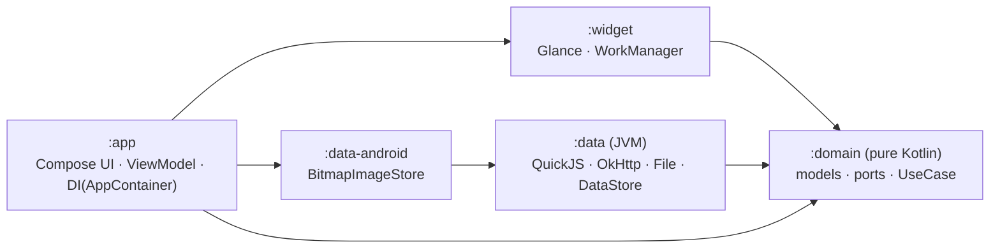
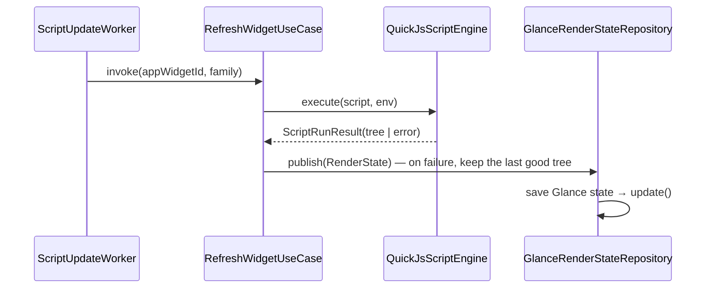

# ScriptWidget

**English** | [한국어](README.ko.md)

[](https://github.com/b1ink301/ScriptWidget/actions/workflows/ci.yml)
[](https://github.com/b1ink301/ScriptWidget/releases)
[](LICENSE)

Like iOS [Scriptable](https://scriptable.app/), **ScriptWidget is an app for building Android home screen widgets in JavaScript**. You can import Scriptable scripts (`.js`, `.scriptable`) and run most of them as they are.

- Repository: https://github.com/b1ink301/ScriptWidget · License: [GPL-3.0](LICENSE)
- Distribution: GitHub releases (not Google Play → [Distribution policy and permissions](#distribution-policy-and-permissions))
- JS engine: [QuickJS](https://github.com/dokar3/quickjs-kt) (`io.github.dokar3:quickjs-kt`) · Widgets: Jetpack Glance · App UI: Jetpack Compose
- Background refresh: exact alarms (`refreshAfterDate`, or a catch-up 15 minutes later if not set) + WorkManager (60-minute safety net). **When the screen is off, nothing runs; widgets refresh as soon as the screen turns on** (saves battery)

## Features

- **Scriptable-compatible API**: `ListWidget`, stacks, text, images, `DrawContext`, `Request`, `FileManager`, `Keychain`, `Location`, `Calendar`/`Reminder`/`Contact`, `Notification`, `Alert`/`UITable`/`WebView`, `Intl` and more ([Supported JS API](#supported-js-api)). Also handles `scriptable://` links and iOS paths
- **Gallery**: 23 samples including calendar, to-dos, month calendar, D-day, weather, crypto, RSS and world clock, plus 8 designer templates; add https `index.json` catalogs (review code and permissions before installing), updates ([Gallery](#gallery-samples-and-script-market))
- **Widgets**: small/medium/large, widget parameter, tap and button actions (Android extension), light/dark colors, transparent background
- **Widget designer**: drag and place text, time, symbols, images (URL or file bookmark photo) and stacks without code, and connect data blocks such as battery, weather, events, to-dos, D-day, progress, world time and JSON. Choose a font (serif, monospace, your own font file). The preview is drawn by the real engine, and saving produces a Scriptable script ([Widget designer](#widget-designer))
- **Editor**: syntax highlighting, autocomplete, find/replace, preview (per size), console, run history, API reference
- **Import & export**: open and share `.js`/`.scriptable`, full zip backup/restore, file bookmarks (`bookmarkedPath`)
- **Ways to run**: app, widget, share sheet, notification, home screen shortcut, broadcast from automation apps (Tasker, etc.)
- **한국어 · English**: the app screens, gallery, API reference and designer templates come in both languages. The app follows the device language, and on Android 13 and later you can pick the app language separately in the Settings tab ([Language](#language-korean--english))
- **Efficiency**: one run at a time per widget, skipping when offline, reusing recent locations, HTTP cache, cleanup of cache and temporary files

## Architecture (Clean Architecture)



- **Dependencies point only inward (`:domain`).** `:widget` depends only on `:domain`, and concrete data implementations are assembled in a single place, `AppContainer` (Composition Root) in `:app`.
- `:domain` and `:data` are **JVM modules with no Android dependencies**. The JVM artifact of quickjs-kt includes macOS/Linux natives, so the QuickJS engine and `prelude.js` are verified with JVM unit tests without a device. When the app uses the same dependency, the Android variant is selected.
- `prelude.js` and the sample scripts are classpath resources of `:data`, so the JVM tests and the APK use the same files.

```
domain/        model(WidgetTree, WidgetFamily, RenderState…) · engine/ScriptEngine · repository/* · scheduler/* · usecase/*
               testFixtures/  Fake repositories, engine, scheduler (reused by other modules' tests)
data/          engine/QuickJsScriptEngine, Prelude · http/OkHttpGateway · files/(SandboxedFileSystem, FileBookmarkStore)
               gallery/(BuiltinCatalogSource, RemoteCatalogSource, install record and catalog URL stores) · history · backup · repository/*
               resources/prelude/*.js, resources/samples/(catalog.json, *.js)
data-android/  BitmapImageStore (BitmapFactory downsampling + per-run cache)
widget/        render/(GlanceRenderer, ScriptWidgetContent, Styles, ImageFileDecoder) · state/(GlanceRenderStateRepository, RenderStateCodec)
               work/(ScriptUpdateWorker, ScriptWorkerFactory, WorkManagerRefreshScheduler, WidgetFamilyResolver) · ScriptWidget, Receiver, RefreshAction
app/           di/AppContainer · ScriptWidgetApp(Configuration.Provider, WidgetDependencies.Provider)
               ui/list, ui/editor, ui/config, ui/gallery, ui/bookmarks, ui/history, ui/api, ui/permissions (ViewModel + stateless Screen)
               ui/preview · ui/scriptui · share · automation · deeplink · pin/WidgetPinner
```

### Execution flow



## Development approach: TDD

Every feature was built in the order **write the test first (Red) → implement until it passes (Green) → clean up (Refactor)**.

| Layer | Test type | Location | Count |
|---|---|---|---|
| domain | JVM unit tests (using Fakes, import/export, backup/restore, icon header, run history, automation runs, file bookmarks, gallery install/update/catalog URL, app update check/version comparison, design model/edit rules/header/templates, catalog validation, event triggers) | `domain/src/test` | 175 |
| data | JVM unit tests: real QuickJS and prelude contracts (per API), MockWebServer, sandbox, DataStore, SF→Material mapping, app UI/system/personal data bridges, reminder store, sample scripts, run context (config, args), text styles, API list, run history file, zip backup, reading GitHub releases, designer code generation (run with real QuickJS and compared), built-in catalog validation, trigger store | `data/src/test` | 280 |
| widget | JVM unit tests (RenderStateCodec, StackLayout (space distribution, 10-child limit, title shrinking), text rendering method selection, available width) | `widget/src/test` | 30 |
| app | JVM unit tests (ViewModel, permission screen and request flow, deep links, script UI host, syntax highlighting/autocomplete/find, share content classification, icons, file bookmarks, gallery, tab navigation rules, list search/activity, update check, designer editing/undo/preview, pre-install permission warning, trigger screen) | `app/src/test` || 143 |
| data-android | Device integration tests (Bitmap, Keystore, LocationManager, Notification, Canvas, symbols, Device, clipboard/share/mail/TTS intents, CalendarProvider, ContactsProvider, MediaStore, document read/write, notification tap and buttons) | `data-android/src/androidTest` | 50 |
| widget | Device integration tests (Glance rendering/gradients/borders/buttons, text bitmaps, WorkManager, exact alarms, Worker, widget actions, event watching (content URI, constraints, midnight alarm)) | `widget/src/androidTest` | 65 |
| app | Device integration tests (AppContainer + real stack, production DI wiring, permission state, Compose script UI, share/open intents, copying shared files, automation and shortcuts, app preview layout, gallery, floating tab bar and settings, drawing a widget in one pass without a session, update row, designer screen and new script picker, trigger screen) | `app/src/androidTest` ||| 67 |
| **Total** | | | **810** (+ 1 compatibility measurement harness, skipped by default) |

```bash
export JAVA_HOME="/Applications/Android Studio.app/Contents/jbr/Contents/Home"

# Unit tests (no device needed)
./gradlew :domain:test :data:test :widget:testDebugUnitTest :app:testDebugUnitTest

# Integration tests (emulator/device needed). If several devices are connected, specify the target
export ANDROID_SERIAL=emulator-5554
./gradlew :data-android:connectedDebugAndroidTest :widget:connectedDebugAndroidTest :app:connectedDebugAndroidTest
```

Bugs caught by tests:
- The alpha hex in `prelude.js` colors was output in lowercase (`#ff112233` → `#FF112233`)
- After a rename, widget bindings stayed on the old name (`RenameScriptUseCase` now moves the bindings too)
- Right after pinning a widget, the periodic work ran before the binding was saved, briefly showing an error screen (`ScheduleBoundWidgetsUseCase`)
- On binding, the script ran twice: once from `refreshNow` and once from the first periodic run (periodic work initialDelay 15 minutes)
- Keychain values were written with `apply()` (asynchronous save) and could be lost in short-lived Workers (changed to `commit()`)
- Fields with default values (`systemName`, `isPad`) were missing from the `Device` info JSON (kotlinx.serialization `encodeDefaults`)
- `java.net.URI` rejected `scriptwidget://` (app open links)
- `StackOverflowError` crash on app start from a DI cycle: WorkManager's on-demand initialization asks the Application for the worker factory, and the factory was eagerly creating a UseCase that needs the scheduler (= WorkManager). Reproduced with `ProductionWiringTest`, which verifies the production wiring as is, then fixed by resolving the dependency lazily

## Installation

Download an APK from [Releases](https://github.com/b1ink301/ScriptWidget/releases) and install it. Most phones need `-arm64-v8a.apk`; if unsure, use `-universal.apk`. On the first install you must allow installing "unknown apps". To update, install a new APK signed with the same key over the existing one. Opening the **Settings** tab checks the latest release and, if there is a new version, shows **New version vX.Y.Z**; tap it to download the APK for this device (development debug builds have a different signature and can't be installed over).

## Screens

You move between screens with the tab bar floating at the bottom. Screens such as the editor, permissions and file bookmarks open full screen without the tab bar, and Back returns to the original tab. Pressing Back in another tab goes to **My scripts**, and pressing it once more there closes the app.

| Tab | Contents |
|---|---|
| **My scripts** | Script list and search, "n widgets · ran n min ago" for each script, **+ New script** at the top (Write code / designer templates), script **⋮** (Export, shortcut, icon, delete) |
| **Gallery** | Install, open and update samples and catalogs, **+ Catalog** |
| **History** | Run history |
| **Help** | API reference |
| **Settings** | Permissions (including running from automation apps), **Refresh while the screen is off** (off by default), file bookmarks, import, full backup and restore, catalog management, **Check for updates**, version, GitHub, license |

## Build & run

```bash
./gradlew :app:installDebug
```

1. Open a script in the app and tap **▶ Run** → check the preview, console and run time in the "Result" tab
2. Add a widget to the home screen with the **Pin** button (or launcher widget list → ScriptWidget → Script)
3. Tapping the widget refreshes it immediately; widgets/elements with a `url` open that URL
4. Saving or renaming a script re-runs every widget that uses it

### Importing / exporting scripts

- **Import**: **Settings** tab → **Import scripts** → choose one or more files in the system file picker. Files are also imported when you **open** a `.js` file **with ScriptWidget** or **share** it from a files app or browser.
  - `.js` `.txt`: the file name (without extension) becomes the script name.
  - `.scriptable` (iOS Scriptable export file): the `name` and `script` inside are extracted, and `icon` (color and glyph) is saved as an icon comment at the top of the script. ScriptWidget also appears as a candidate when you **open** or **share** a `.scriptable` file from a files app (the type is `application/octet-stream`, so it may also show up for other unknown files; anything that isn't a script is rejected).
  - If the name already exists, nothing is overwritten; the script is saved as `name 2`, `name 3`…. When you import a single file, the editor opens right away.
  - Binary files, empty files and files over 1MB are rejected with a reason.
- **Export**: **⋮ → Export** next to a script → choose where to save; it is saved as `name.js`.
- **Full backup / restore**: **Settings** tab → **Back up everything** saves all scripts into a single zip. **Restore from backup** adds missing scripts, skips identical ones, and adds `name 2` when the name is the same but the content differs (no overwriting).
- **Icon & color**: **⋮ → Icon & color** next to a script. It is saved the same way as Scriptable (a `// icon-color: …; icon-glyph: …;` comment at the top of the file), so scripts imported from Scriptable keep their icons.

### Gallery (samples and script market)

The **Gallery** tab. Browse scripts by category (Calendar & To-dos / Everyday / Info / Examples) and **Install**, **Open** or **Update** them.

| Category | Built-in samples |
|---|---|
| Calendar & To-dos | Today's Events (calendar), To-dos (tap ○ in the widget to complete, add in the app), This Month, D-day (`2026-12-25 Christmas`) |
| Everyday | Battery, Memo (edit in the app), Water & Habit Tracker (`Water 8`, + button), Photo Frame (file bookmark `photo`), Upcoming Birthdays (contacts) |
| Info | Day, Week, Month & Year Progress, Crypto Prices (Upbit, no key needed), RSS News (Yonhap News by default), Quote of the Day, World Clock |
| Examples | 9 existing samples (01_hello ~ 09_counter) |

- **The built-in gallery reads [`samples/catalog.json`](data/src/main/resources/samples/catalog.json) in this repository.** So when you fix a sample (bump the entry's `version`) or add a new one and push it to `main`, the gallery shows **Update** and new entries without a new app release. When offline or when the download fails, the copy bundled in the app is used.
- On first install, all gallery samples are added to the script list (with install records, so they can be updated later). If there are already scripts, nothing is added.
- If the name already exists, nothing is overwritten; it is installed as `name 2`. When the gallery version is higher, **Update** appears; if you edited the script after installing it, your script is left alone and the new version is installed as `name 2`.
- **Adding catalogs** (**+ Catalog** at the top right): add an `index.json` at an https address and its list shows up in the gallery too (e.g. a raw URL from a GitHub repository). For scripts from elsewhere, **the code and required permissions are shown before installing**, and exactly the code you reviewed is installed. Catalogs that fail to load are shown with the error, and removing a catalog keeps the scripts you installed.

`index.json` format (`script` is a path relative to index.json or an https address):
```json
{
  "title": "My widgets",
  "entries": [
    {
      "id": "clock", "name": "World Clock", "title": "World Clock", "category": "Info",
      "description": "Current time in several cities", "script": "scripts/clock.js", "version": 2,
      "sizes": ["small", "medium"], "permissions": ["network"], "author": "me"
    }
  ]
}
```
`permissions` values: `calendar` `contacts` `location` `network` `notification` `photos` (for display). Bumping `version` shows an update to users who installed it.
Optional fields: `translations` (title, description and category per language), `localizedScripts` (script per language, e.g. `{"en": "designs/clock.en.js"}` — the code matching the app language is installed), `seed: false` (not installed automatically on first run).

- **Designs category**: contains 8 designer templates (Clock, Battery, Next event, Reminders, Weather, JSON value, Photo frame, D-day), which open in the designer when installed. The files are in `samples/designs/` and are generated from `DesignTemplates`. If you change a template, regenerate them with `./gradlew :data:test --tests '*DesignSamplesTest*' -PwriteDesigns` (otherwise the test fails). The official online catalog reads the `main` branch, so this category appears in the online gallery after it is merged into `main` (until then it shows only from the app's copy when offline).

- **Contributing samples and catalog validation**: see [CONTRIBUTING.md](CONTRIBUTING.md). CI validates the built-in catalog: the fields, and **whether the APIs the code uses match `permissions`**. You can check your own catalog with `./gradlew :data:test --tests '*CatalogFileCheck*' -Pcatalog=/path/to/index.json`.
- When installing a remote script, a **⚠️ warning** appears in the confirmation dialog if the code uses permissions not listed in the catalog.

### Widget designer

Choose a template (Blank widget, Clock, Battery, Next event, Reminders, Weather, JSON value, Photo frame, D-day) in **+ New script** → **Build with the designer** to open the designer. The same templates are also in the gallery's **Designs** category.

- **Screen**: preview at the top (S, M, L), with **Outline** (element tree) and **Properties** (selected element) below. Tapping an element in the preview also selects it.
- **Elements**: text, time (live), symbol (SF Symbols name), image (URL or file bookmark photo), spacer, horizontal and vertical stacks. The selected element can be wrapped in a stack or deleted. Undo (↶) and redo (↷).
- **Reordering**: drag the **≡** handle in the outline list. Dropping on the upper/lower part of a row places it before/after that row; dropping in the middle of a stack row puts it inside that stack. The up/down buttons are still there.
- **Photos (file bookmarks)**: switch an image's source to **File bookmark**, or pick a photo with **+ Pick a photo** in the whole widget's **Background picture**; it is saved as a new file bookmark (`photo`, `photo 2`…) and used right away. On devices without the bookmark, a placeholder is drawn instead.
- **Fonts**: per text, System, Serif, Monospace, or a `.ttf`/`.otf` added with **+ Font file** (saved in `Documents/fonts`, same as `new Font("name", size)` in a script). Android has no rounded system font, so "Rounded" isn't offered.
- **Data blocks**: values that go into the `{value}` slot of a text — date text (with format), battery, next event (title, time), reminders (remaining count, most urgent), weather (temperature, condition, Open-Meteo), JSON value (URL + a path like `data.0.name`), widget parameter, **D-day** (`D-12`, `D-DAY`, `D+3`, optionally repeating every year; if the date is blank, the date and name are read from the widget parameter `2026-12-25 Christmas`), **Progress** (today, this week, this month, this year %), **World time** (`HH:mm` in a time zone like `Europe/London`). If a value can't be fetched, `–` is shown. The generated script includes code only for the blocks it uses (e.g. the clock design has no location or calendar code).
- **Whole widget**: background color and gradient, padding, spacing, requested refresh (`refreshAfterDate`), URL to open on tap.
- **Preview = real widget**: on every change, the Scriptable code is regenerated and run by the real engine to draw it (data blocks show real values too).
- **Saved format**: a regular Scriptable script. The design is stored along with it in a top comment `// scriptwidget-design: {...}`, so opening it from the list opens the designer. The **Code** button shows the generated code, and the editor's **Design** button brings you back.
- **If you edit the code directly**: that script opens in the editor. Reopening it in the designer shows a warning, and saving there regenerates the code from the design (your manual edits are lost).
- **Export for a gallery**: **⋮** at the top right of the designer → **Export for a gallery**. Saves a zip with the script (`<id>.js`) and the entry for `index.json` (`entry.json`, permissions computed automatically from the code). Upload it to your own catalog or send a PR following the [contributing guide](CONTRIBUTING.md).

### Ways to run a script

| Method | Values the script sees |
|---|---|
| Editor **▶ Run** | `config.runsInApp` |
| Home screen widget (periodic refresh, tap, button) | `config.runsInWidget`, `args.widgetParameter`, `args.widgetAction` |
| `scriptwidget://run?scriptName=…&key=value` link | `config.runsInApp`, `args.queryParameters` |
| **Share → Run with script** in another app → choose a script | `config.runsInActionExtension`, `args.plainTexts` `args.urls` `args.images` `args.fileURLs` (files are copied to the sandbox `tmp/share/`) |
| Tapping a notification scheduled by the script | `config.runsInNotification`, `args.notification` (including `userInfo`) |
| Home screen shortcut (**⋮ → Add shortcut to home screen**) | `config.runsFromHomeScreen` |
| Automation apps (Tasker, MacroDroid, etc.) | `config.runsFromAutomation`, `args.shortcutParameter` — see below |
| **Automatic triggers** (Settings tab) | Calendar or contacts changes, new photo, midnight, time zone change, charging, Wi-Fi — `config.runsFromTrigger`, `args.trigger` — [see below](#automatic-triggers) |

**Automation app integration** (only when **Run from automation apps** is turned on in the permissions screen):
- Run: broadcast `kr.b1ink.scriptwidget.action.RUN_SCRIPT`, extras `scriptName` (required) and `parameter` (optional). Runs in the background without a screen (UI APIs throw errors).
- Result: when done, broadcast `kr.b1ink.scriptwidget.action.SCRIPT_RESULT`, extras `scriptName`, `output` (JSON of the `Script.setShortcutOutput()` value) and `error`.
- Other apps can also receive the result broadcast, so don't pass sensitive values through `setShortcutOutput`.

### Automatic triggers

**Settings → Automatic triggers → + Trigger**: choose "When / Which script / What".

| When | Implementation (no always-running service) | `args.trigger` |
|---|---|---|
| When the calendar changes · When contacts change · When a new photo is added | WorkManager content URI trigger (multiple changes within 5 seconds to 1 minute are batched into one) | `calendar` `contacts` `photo` |
| When the day changes (midnight) | An alarm that doesn't wake the screen → if the screen is off, the next time it turns on | `day` |
| When the time zone or time changes | System broadcasts (`TIMEZONE_CHANGED`, `TIME_SET`) | `timezone` |
| While charging · While on Wi-Fi | WorkManager constraints, 1-hour pause after a run | `charging` `wifi` |

- **Refresh widgets**: redraws the widgets that use that script. The minimum interval (5 minutes) is skipped, but the policies of running when the screen turns on if it's off and skipping when offline still apply.
- **Run script**: runs right away in the background (recorded as "Trigger" in the History tab). `config.runsFromTrigger` is `true`, and `args.trigger` tells you which event it was.
- Events that aren't used aren't registered with the system. They are registered again after an app update or reboot.
- Emulator check: the script ran as "Trigger" when a photo was added and when the time zone changed (Seoul → Tokyo → Seoul).

### Language (Korean · English)

- The default resources are English (`values/`) and Korean is in `values-ko/`. Korean devices show Korean; all other languages show English.
- **Settings → App language** (Android 13 and later): System default / 한국어 / English. It also appears in the system's per-app language settings (`locales_config.xml`).
- **Gallery**: uses `translations.en` (title, description, category) and `titles.en` from the `catalog.json` entries. If the online catalog is older than the app and lacks translations, the translations from the copy bundled in the app are borrowed. You can put the same fields in your own catalog.
- **Designer**: the text and date formats of new templates, and the default text in the code generated on save (일정 없음/No events, weather names, etc.), follow the app language.
- **Widget errors**: the app's own errors, such as "No script is set", are passed as codes and translated into the app language when the widget is drawn. Errors raised by scripts are shown as they are.
- Text that sample scripts draw on widgets (e.g. "오늘 일정") is script content and isn't translated.
- Device tests run with `KoreanLocaleTestRunner`, which fixes the app language to Korean, and `EnglishUiTest` checks the English screens.

### Editor, run history and help
- **Editor**: line numbers, syntax highlighting (keywords, strings, numbers, comments, API names), autocomplete above the keyboard (static members after `Font.`, that class's methods after a variable created with `new ListWidget()`, otherwise APIs, keywords and names declared in the script), **find/replace** (case-insensitive, replace all).
- **Run history**: the **History** tab. Keeps up to the latest 200 runs from the app, widgets, notifications, share and automation (time, where it ran, duration, errors and logs). **Failures only** filter.
- **API reference**: the **Help** tab or the editor's **API** button. The list is built by inspecting the prelude directly with QuickJS (constructors, method arguments, properties, async or not), so it always matches the implementation. Each entry links to the official docs.

## Supported JS API

| API | Support |
|---|---|
| `ListWidget` | `addText` `addDate` `addImage` `addStack` `addSpacer` `backgroundColor` `backgroundGradient` `backgroundImage` `setPadding` `spacing` `url` `refreshAfterDate` `presentSmall/Medium/Large` |
| `WidgetStack` | The above + `layoutHorizontally/Vertically` `top/center/bottomAlignContent` `cornerRadius` `size` `borderColor` `borderWidth` |
| `WidgetText` | `textColor` `font` `textOpacity` `lineLimit` `left/center/rightAlignText` `url` `shadowColor` `shadowRadius` `shadowOffset` `minimumScaleFactor` |
| `WidgetDate` | `applyTimeStyle/DateStyle/RelativeStyle/TimerStyle` |
| `WidgetImage` | `imageSize` `cornerRadius` `url` `tintColor` `left/center/rightAlignImage` `applyFitting/FillingContentMode` (`resizable` and `containerRelativeShape` are ignored) |
| `LinearGradient` | `colors` `locations` `startPoint` `endPoint` |
| `SFSymbol` | `named()` `image` `applyFont` `apply*Weight` — **replaced with Material Icons** (340 SF names mapped directly + variants like `.fill` and `.circle` fall back to the base form; otherwise a placeholder + warning) |
| `DrawContext` `Path` `Rect` | Color, line, font and alignment settings, `fill/strokeRect` `fill/strokeEllipse` `addPath` `fill/strokePath` `drawText(InRect)` `drawImage*` `getImage` / `move` `addLine` `addQuadCurve` `addCurve` `addRect` `addRoundedRect` `addEllipse` `addLines` `addRects` `closeSubpath` / `Rect`'s `min/mid/maxX·Y` `origin` `size` |
| `Device` | `name` `systemName` `systemVersion` `model` `isPhone/isPad` `screenSize/Resolution/Scale/Brightness` orientation `batteryLevel` `isCharging` `isFullyCharged` `preferredLanguages` `locale` `language` `isUsingDarkAppearance` `volume` |
| `UUID` `Timer` | `UUID.string()`, `Timer.schedule` / `new Timer()` `timeInterval` `repeats` `invalidate` |
| `RelativeDateTimeFormatter` | `string(date, ref)` named/numeric styles (English, Korean) |
| `XMLParser` | SAX-style callbacks (`didStartElement` `foundCharacters` `didEndElement` `parseErrorOccurred` …), DTD and external entities disabled |
| `Safari` `URLScheme` | `open` `openInApp` (not available during a widget refresh) / `forRunningScript` `forOpeningScript` `forOpeningScriptSettings` `forOpeningApp` `parameter` `allParameters` — the app handles `scriptwidget://run?scriptName=…` deep links |
| `Request` | `url` `method` `headers` `body` `timeoutInterval` `load` `loadString` `loadJSON` `loadImage` `response` |
| `FileManager` | `local()` `iCloud()` (=local) `documents/cache/temporaryDirectory` `joinPath` `read/write` `readString/writeString` `readImage/writeImage` `fileExists` `isDirectory` `createDirectory` `listContents` `remove` `fileName` `fileExtension` `modificationDate` `fileSize` — paths outside the app's own sandbox are rejected · file bookmarks `bookmarkedPath` `bookmarkExists` `allFileBookmarks` (in **Settings** tab → **File bookmarks**, give a name and choose a file; it is copied into the app) |
| `Keychain` | `set` `get` (throws if missing) `contains` `remove` — encrypted with Android Keystore AES-GCM |
| `Location` | `current()` `setAccuracyTo*()` `reverseGeocode()` — on failure, the last location (only with permission) |
| `importModule` | Other scripts as CommonJS modules (`module.exports`, caching, circular references) |
| `Data` | `fromString` `fromBase64String` `fromBytes` `fromFile` `fromPNG/JPEG` `toRawString` `toBase64String` `getBytes` |
| `Image` | `Image.fromData` `Image.fromFile` |
| `Notification` | `title` `subtitle` `body` `openURL` `threadIdentifier` `userInfo` `scriptName` `addAction` `setTriggerDate` `schedule` `remove` `removePending/Delivered` `allPending` `allDelivered` `current` `resetCurrent` — tapping runs the `scriptName` script with `args.notification` |
| `Intl` (partial) | `Intl.NumberFormat` (decimal/percent/currency, fraction digits, grouping), `Intl.DateTimeFormat` (dateStyle/timeStyle/timeZone, weekday·year·month·day·hour·minute·second·hour12 — Korean, Chinese, Japanese and English ordering, calling without `new`, `resolvedOptions()`), `toLocaleString/DateString/TimeString` |
| `DateFormatter` | `dateFormat` pattern `string()` `date()` `locale` `use*DateStyle/TimeStyle` |
| `Color` `Font` `Size` `Point` | `new Color(hex, alpha)`, built-in colors, `Font.*SystemFont(size)` etc. |
| `Alert` | `title` `message` `addAction` `addDestructiveAction` `addCancelAction` `addTextField` `addSecureTextField` `textFieldValue` `present` `presentAlert` `presentSheet` |
| `UITable` `UITableRow` `UITableCell` | `addRow` `removeRow` `removeAllRows` `reload` `present` `showSeparators` / `height` `isHeader` `dismissOnSelect` `onSelect` `backgroundColor` / `text` `image` `imageAtURL` `button` (`onTap`) alignment, font, color. Supports nested tables (presenting a table from within a table); tables close automatically when the script ends with an error |
| `DatePicker` `QuickLook` | `pickDate` `pickTime` `pickDateAndTime` `pickCountdownDuration` `minimumDate` `maximumDate` `initialDate` / `present` (text, image, JSON) |
| `WebView` | `loadURL` `loadRequest` `loadHTML` `loadFile` `evaluateJavaScript` (including the `completion` callback) `getHTML` `present` `waitForLoad` `shouldAllowRequest` static `loadURL/HTML/File` |
| `DocumentPicker` | `open` `openFile` `openFolder` `export` `exportString` `exportImage` `exportData` — uses the system file picker (SAF); chosen files are copied into the sandbox |
| `Pasteboard` `ShareSheet` | `copy(String)` `paste(String)` `pasteImage` / `present` (strings, URLs, images, Data) |
| `Mail` `Message` | `toRecipients` `cc/bccRecipients` `subject` `body` `isBodyHTML` attachments `send` / `recipients` `body` `send` — opens the compose screen of the mail or messaging app |
| `CallbackURL` | `addParameter` `getURL` `open` — x-callback-url; other apps respond with `scriptwidget://x-callback-url/success…` |
| `Speech` `Dictation` | `speak` (TTS) / `start(locale)` (speech recognition) |
| `Calendar` `CalendarEvent` `RecurrenceRule` | Calendar list, default calendar, `forEvents*` / `today` `tomorrow` `yesterday` `thisWeek` `nextWeek` `lastWeek` `between` `save` `remove` `presentEdit` `presentCreate` / daily, weekly, monthly and yearly recurrence rules (RRULE) |
| `Reminder` | `all*` `allDue*` `allIncomplete*` `completed*` `incompleteDue*` `scheduled` `between` `save` `remove`, lists `forReminders*` `createForReminders` |
| `Contact` `ContactsContainer` `ContactsGroup` | `all` `inGroups` `add` `update` `delete` `persistChanges` `image` / `all` `default` `withIdentifier` / `all` `addMember` `removeMember` |
| `Photos` | `latestPhoto(s)` `latestScreenshot(s)` `fromLibrary` `fromCamera` `save` |
| `Script` `config` `args` | `setWidget` `complete` `setShortcutOutput`, `runsInWidget` `runsInApp` `runsInActionExtension` `runsInNotification` `runsFromHomeScreen` `runsFromAutomation` `runsFromTrigger` (Android extension) `widgetFamily`, `args.widgetParameter` `args.widgetAction` `args.queryParameters` `args.plainTexts` `args.urls` `args.fileURLs` `args.images` `args.all` `args.notification` `args.shortcutParameter` `args.trigger` (Android extension) |
| Widget buttons (Android extension) | An element's `tapAction = "name"` or `widget.addButton(title, action)` — tapping re-runs the script without opening the app, and the script can tell which button it was from `args.widgetAction` |
| Globals | `console.*` `log` `setTimeout` `clearTimeout` `sleep(ms)` |

`prelude.js` is split into per-feature files under `data/src/main/resources/prelude/` and concatenated in the order of `index.txt`.

### Behavior notes
- **refreshAfterDate**: schedules one refresh at the given time, and **periodic refreshes before then are skipped**. If the script doesn't set it, a "catch-up" refresh is scheduled 15 minutes after the last run. Manual refreshes such as tap, edit and binding always run immediately.
- **Location (widgets)**: widgets run in the background. If **background location (allow all the time)** is allowed, widgets also use the current location; otherwise they use the **last location** obtained when run in the app (without background permission, `lastKnown` is also null). Scripts can use `timestamp` to judge whether the location is stale.
- **Background refresh policy (battery)**:

  | Situation | Behavior |
  |---|---|
  | Screen on | Refreshes at the requested time, but **at least 5 minutes** after the last run. Alarms are `RTC`, which don't wake the phone |
  | Screen off (default) | Scheduled and periodic refreshes **don't run**. Pending refreshes wait with a non-waking alarm and **run as soon as the screen turns on (including the lock screen)** — by the time you unlock and see the home screen, they're refreshed |
  | Screen off + **"Refresh while the screen is off"** on in the Settings tab | Wakes the phone (`RTC_WAKEUP`) to refresh at intervals of at least **15 minutes**. For scripts that schedule notifications or keep records in the background |
  | Manual (tap, button, edit, widget configuration) | Immediately, regardless of screen state |

  - Widgets whose script doesn't set `refreshAfterDate` also get a "catch-up" alarm 15 minutes after the last run, so they refresh when the screen turns on.
  - If the phone wakes briefly with the screen off and the alarm fires (push notifications, etc.), it doesn't run and is postponed by 2 minutes (it's a non-waking alarm, so no extra battery cost).
  - The WorkManager periodic work is a **60-minute safety net** for when alarms are lost due to a reboot etc., and finishes immediately if the screen is off. Non-waking alarms aren't paired with a WorkManager schedule (because the work could wake the phone while the screen is off).
  - Android's own restrictions (Doze, Samsung "app power saving") can delay refreshes further, independently of this. **Battery optimization exemption** under Settings tab → Permissions is recommended.
- **Preventing duplicate runs**: the same widget runs only one at a time, and scheduled/periodic refreshes of a widget that was just refreshed are skipped. Resizing a widget within the same size class (small/medium/large) only redraws it without running the script.
- **Offline**: without a network, background refreshes of scripts using `Request`, `WebView` or `importModule` are skipped and the last screen is kept. Responses are limited to 10MB, and the HTTP cache (10MB) follows the server's cache headers.
- **Location**: a recent location matching the requested accuracy (precise 1 minute, 100m 5 minutes, 1–3km within 15 minutes) is reused without turning on GPS again. A new fix is attempted only within 15 seconds in total.
- **Storage and memory**: deleting a widget also deletes its image cache, and `tmp` (shared files, camera photos, picked documents) is cleaned up after a day. Opaque images are saved as JPEG and transparent ones as PNG. Widgets with many images decode them smaller to stay within a total bitmap budget (6MB), and long text images are limited to 2048px in height. Run history is appended line by line (JSONL) and trimmed to 200 lines when it reaches 400.
- **refreshAfterDate accuracy**: `USE_EXACT_ALARM` runs exactly at the given time (when the screen is on). If alarms are lost due to a reboot etc., the 60-minute safety-net work runs again and sets the alarm anew. Devices that can't use exact alarms fall back to WorkManager scheduling.
- **Permission requests**: when running from the editor, if the script uses `Location.` / `Notification(` / `CalendarEvent.` / `Contact.` / `Photos.latest…`, only the needed permissions are requested first.
- **App UI (Alert, UITable, WebView, etc.)**: available only when running in the app. Calling them during a widget refresh throws a "…during a widget refresh" error. Time the user spends looking at the screen doesn't count toward the run timeout (app runs have an overall 30-minute cap).
- **Widget buttons**: taps are processed in order per widget (consecutive taps aren't dropped), so you can build stateful widgets like counters. Store state in `FileManager` or `Keychain`.
- **Reminder**: Android has no system reminders app, so reminders are stored in **JSON files inside the app** (`filesDir/reminders/`). If a reminder has a due time and is incomplete, a notification is scheduled for that time (without notification permission, only the notification is skipped; it is still saved).
- **Calendar**: if there's no writable calendar, a local "ScriptWidget" calendar is created and used. `Calendar.presentPicker()` isn't supported.
- **Contacts**: accounts are containers. Contacts saved without an account are in the "local" container. Changes are applied all at once on `persistChanges()`.
- **Photos**: saved photos go into `Pictures/ScriptWidget/`. Picking (`fromLibrary`) uses the system photo picker, so no permission is needed. `removeLatest*` and `Pasteboard.copyImage` aren't supported.
- **SFSymbol**: Android has no SF Symbols, so they are drawn with the Material Icons font (Apache-2.0, about 350KB). Icon shapes may differ.
- **Borders (Glance)**: Glance has no border feature. If a stack has a solid background, the border is drawn exactly; otherwise it's approximated by stretching an outline bitmap underneath (line thickness varies slightly with the stack's aspect ratio).
- **Stacks with flexible Spacers**: the renderer makes them stretch along that axis like Scriptable (RemoteViews by default only takes up the size of its content).
- **iOS Scriptable compatibility**: `scriptable:///run/<name>` and `scriptable:///run?scriptName=` links are handled like `scriptwidget://` (`Safari.open` and widget `url` in iOS scripts). iOS paths hard-coded in scripts (`/var/mobile/Library/Mobile Documents/iCloud~dk~simonbs~Scriptable/Documents/…`, the app's `Documents` and `Library/Caches`) are mapped to the same folders in the sandbox. Invalid color strings like `new Color("default")` give black instead of an error (same as Scriptable).
- **Alignment inside columns**: center and right alignment stretch to full width only when the column takes up the whole width. Stretching in a content-sized column (SwiftUI VStack) would steal the leftover space of the row.
- **Propagation of stretching stacks**: like SwiftUI, if a child wants to stretch via a Spacer, the parent stack also stretches in that direction (horizontal/vertical), and stretching siblings in the same row/column split the space equally (e.g. the 2×2 card grid of Sub Calendar).
- **`Color.dynamic(lightColor, darkColor)`**: both colors are passed to the widget, so it switches immediately when the system light/dark mode changes, without re-running the script.
- **Space distribution in horizontal stacks**: like SwiftUI, children that want to stretch (e.g. left and right columns with a Spacer in each row) split the width equally. In a row like `[rank, title (lineLimit 1), Spacer, publisher]`, the title takes the leftover space and shrinks with an ellipsis, so trailing elements aren't pushed out.
- **10-child limit**: RemoteViews draws only up to 10 children per row/column and drops the rest. The renderer groups overflowing children into inner containers so all are drawn (gaps created by `spacing` count too).
- **Text rendering**: text Glance can't draw is drawn as a bitmap: weights outside the 3 levels (regular/medium/bold), shadows, `minimumScaleFactor` (truncated with an ellipsis if it still overflows at the minimum scale), and fonts placed in `Documents/fonts/<name>.ttf|otf` (`new Font("name", size)`). Names like `Menlo` and `Courier` fall back to the monospace system font, and the `Georgia` and `Times` families to the serif system font.
- **Intl**: not available in QuickJS, so it's implemented with `java.text`/`java.time`. Individual component options like `year`/`month` aren't supported. Output can differ slightly between the JVM (CLDR) and Android (ICU).

## Scriptable compatibility measurement

Runs community widget scripts and measures the share that draw a widget without errors. The scripts aren't included in the repository.

```bash
./gradlew :data:test --tests '*CompatibilityReport*' -PcompatCorpus=/path/to/scripts
cat data/build/compat-report.txt
```

- Network responses are replaced in the harness with "a Proxy that proceeds whatever property is accessed". So it measures missing APIs, not data shapes.
- If `<corpus>/_docs/<script name>/` exists, its contents are put in the Documents folder before running. This measures in the same state (modules, config files) as a user who downloaded the whole repository into Scriptable.

**Measured set**: 33 scripts listed in [awesome-scriptable](https://github.com/dersvenhesse/awesome-scriptable), plus 143 collected on 2026-10-30 from 71 Scriptable widget repositories on GitHub (files using `ListWidget`, up to 4 per repository, deduplicated), for **176** in total.

| Point in time | Set | Scripts that drew a widget without errors |
|---|---|---|
| After completing Track A | 33 | 12 (36%) |
| After API additions (WidgetImage, SFSymbol, DrawContext, Device, etc.) | 33 | 21 (64%) |
| After implementing app UI, WebView, system integration, personal data | 33 | 23 (70%) |
| Measured set expanded (2026-10-30) | 176 | 80 (45%) |
| `module` global, `arguments`, `atob`/`btoa`, Documents modules + providing repository files | 176 | **101 (57%)** |

What was found and added while expanding the measured set:
- **`module` global**: Scriptable gives every script `module.filename` and `module.exports`. Scripts use them to check whether iCloud is used or to compute module paths (13 scripts).
- **Top-level `arguments`**: scripts run inside a function, so it exists as in Scriptable.
- **`atob` / `btoa`**
- **`importModule` also searches the Documents folder**: modules can be loaded with subfolder paths or absolute paths inside Documents, including modules the script downloaded and saved.

The remaining 75 failures aren't missing APIs.

| Cause | Count |
|---|---|
| Stops because of the shape of the harness's fake responses (needs real API responses) | 35 |
| Needs a widget parameter, API key or bookmark setup | 14 |
| Must first be run in the app to configure (widgets can't show an `Alert`, same in Scriptable) | 5 |
| Bugs in the script itself (undefined variables, calls to nonexistent APIs like `ListWidget.centerAlignContent`, etc.) | 7 |
| Needs modules or files not in the repository | 4 |
| Other (app-only scripts, offline handling, etc.) | 10 |

All 60 APIs in [docs.scriptable.app](https://docs.scriptable.app/) are implemented. Some iOS-only features (`Calendar.presentPicker`, `Photos.removeLatest*`, `Pasteboard.copyImage`) throw a clear error when called.

## Distribution policy and permissions

ScriptWidget is **distributed through GitHub, not Google Play**. That's why it uses permissions that are hard to use under Play policies. Users can see the state and purpose of each permission and allow it in the app's **Permissions** screen (**Settings** tab → Permissions). If a permission important for widgets is missing, a banner appears on the list screen.

| Permission | Purpose | How it's requested | If distributed on Play |
|---|---|---|---|
| `POST_NOTIFICATIONS` | `Notification` | System dialog (Android 13+) | Allowed |
| `ACCESS_FINE/COARSE_LOCATION` | `Location` | System dialog | Allowed |
| `ACCESS_BACKGROUND_LOCATION` | Current location during widget refresh | "Allow all the time" in system settings after allowing location | Requires review, practically difficult |
| `REQUEST_IGNORE_BATTERY_OPTIMIZATIONS` | Widget refresh even in power saving | System dialog | Restricted by policy |
| `USE_EXACT_ALARM` (+ `SCHEDULE_EXACT_ALARM` on API 31–32) | On-time refresh for `refreshAfterDate` | Granted automatically on install | Only alarm and calendar apps |
| `READ/WRITE_CALENDAR` | `Calendar` `CalendarEvent` | System dialog | Allowed (purpose explanation required) |
| `READ/WRITE_CONTACTS` | `Contact` `ContactsContainer` `ContactsGroup` | System dialog | Allowed (purpose explanation required) |
| `READ_MEDIA_IMAGES` (`READ_EXTERNAL_STORAGE` on API 32 and below) | `Photos.latest*` | System dialog | Only when it's a core feature |

- When a script run from the editor uses the APIs above, the needed permission is requested at that moment.
- When the system no longer asks for a permission (denied twice), you are directed to the app settings screen.
- `Reminder`, `Photos.fromLibrary/fromCamera/save`, `DocumentPicker`, `Pasteboard` and `Mail`/`Message` (only open the compose screen) need no permissions. The camera uses the system camera app, so the `CAMERA` permission isn't declared.

## Release signing

`app/build.gradle.kts` looks for signing information in the order below. If neither exists, the release APK isn't signed. R8 (code shrinking and obfuscation) is enabled for release builds.

1. `../keystore/scriptwidget.properties` (outside the repository, in the same place as other apps' key files)
2. Environment variables `SCRIPTWIDGET_KEYSTORE_FILE` `SCRIPTWIDGET_KEYSTORE_PASSWORD` `SCRIPTWIDGET_KEY_ALIAS` `SCRIPTWIDGET_KEY_PASSWORD` (for CI)

### Creating a key (once)

```bash
cd ../keystore
keytool -genkeypair -v -keystore scriptwidget-release.jks -alias scriptwidget \
  -keyalg RSA -keysize 4096 -validity 36500 \
  -dname "CN=<name>, O=<organization or individual>, C=KR"
# Enter passwords at the prompt (so they don't end up in the command history)
```

`../keystore/scriptwidget.properties`:

```properties
storeFile=scriptwidget-release.jks
storePassword=<keystore password>
keyAlias=scriptwidget
keyPassword=<key password>
```

```bash
./gradlew :app:assembleRelease                      # app/build/outputs/apk/release/app-<abi>-release.apk (per ABI + universal)
./gradlew :app:signingReport                        # check the SHA-256 fingerprint for registration
apksigner verify --print-certs app/build/outputs/apk/release/app-universal-release.apk
```

### CI/CD (GitHub Actions)

| Workflow | When | What it does |
|---|---|---|
| [`ci.yml`](.github/workflows/ci.yml) | Pushes to `main`/`develop`, PRs, manual | **Tests**: unit tests (domain, data (QuickJS), widget, app) → debug APK (artifact) → device tests on an emulator (API 35)<br>**Checks** (in parallel): code style (ktlint) → Android Lint → R8 release build (unsigned)<br>Failed tests and checks are left as GitHub annotations with their names and messages |
| [`release.yml`](.github/workflows/release.yml) | `v*` tag push | Unit tests → signed release APKs (arm64-v8a, armeabi-v7a, x86_64, universal) → signature verification and SHA-256 → create a GitHub release |

| [`dependabot.yml`](.github/dependabot.yml) | Every Monday | Groups Gradle dependency and GitHub Actions updates into PRs to `develop` |

**Code style and Lint**
- Check with `./gradlew spotlessCheck` and fix with `./gradlew spotlessApply`. The rules are IntelliJ-style ktlint, with the line-wrapping rules that would change existing one-line signatures, expression bodies and call chains turned off (`ktlintRules` in `build.gradle.kts`).
- Android Lint records existing warnings in a per-module `lint-baseline.xml` and fails **only on new errors**. To regenerate the baseline, run `./gradlew updateLintBaseline`. A deep link crash on Android 12 and below (API 33-only `URLDecoder.decode`) found when Lint was first added has been fixed.
- detekt isn't included yet because there's no stable release supporting Kotlin 2.4 (1.23.8 doesn't support it, 2.0 is alpha).

Creating a release:
```bash
git tag v0.2.0 && git push origin v0.2.0      # versionName 0.2.0, versionCode 200 (major*10000+minor*100+patch)
```
Tags with a `-`, like `-beta.1`, are published as pre-releases.

The release workflow signs with the secrets below in the repository's **Settings → Secrets and variables → Actions** (if missing, it fails and tells you why):

| Secret | Value |
|---|---|
| `SCRIPTWIDGET_KEYSTORE_BASE64` | Output of `base64 -i ../keystore/scriptwidget-release.jks \| pbcopy` |
| `SCRIPTWIDGET_KEYSTORE_PASSWORD` | Keystore password |
| `SCRIPTWIDGET_KEY_ALIAS` | `scriptwidget` |
| `SCRIPTWIDGET_KEY_PASSWORD` | Key password |

- **If you lose the key and passwords, existing installs can't be updated.** Keep them in at least two places outside the repository (password manager + offline backup).
- To prepare for Android developer verification in 2027, register **the package name `kr.b1ink.scriptwidget` and this key's SHA-256 fingerprint** in the Android Developer Console. The package name can't be changed after registration (changing it makes it a different app).
- How it was verified: installed an R8 release APK signed with a temporary key on an emulator, ran 7 samples via deep links and pinned widgets to confirm they work.

## PoC results (2026-10-28, emulator sdk_gphone16k_arm64)

| # | Question | Result |
|---|---|---|
| Q1 | QuickJS background execution | ✅ Runtime creation 1–28ms, prelude 1–11ms. Works on 16KB page devices too |
| Q2 | async/await + network | ✅ `Promise.all`, `setTimeout/clearTimeout` (302ms measured for a 300ms wait), `loadJSON` work. Error line numbers (`04_error.js:5:1`) are accurate |
| Q3 | Widget tree → Glance | ✅ Renders Text / Date / Image / Stack (H·V) / Spacer / background / padding / rounded corners |
| Q4 | Image size limits | ✅ Remote images are stored at ≤512px and decoded to the display size when rendering |
| Q5 | Periodic refresh and tap | ✅ WorkManager periodic work registered per widget, re-runs on tap, re-runs only when the size class changes |

- Run time: hello 2–6ms, exchange rate API about 0.9s, image + GitHub API about 1.3–1.5s (including network)
- `libquickjs.so` size: about 790KB for arm64 (about 3MB with all 4 ABIs → ABI split recommended for distribution)

### Known limitations / next steps

- `cornerRadius` applies only on API 31 and above
- Next candidates: long-term battery measurement on a real device, running a community catalog

## License

ScriptWidget is distributed under the [GNU General Public License v3.0](LICENSE). If you modify or redistribute it, you must publish the source under the same license.

Open source used:

| Component | License |
|---|---|
| [quickjs-kt](https://github.com/dokar3/quickjs-kt) | Apache-2.0 |
| [QuickJS](https://bellard.org/quickjs/) | MIT |
| [OkHttp](https://square.github.io/okhttp/) | Apache-2.0 |
| AndroidX (Compose, Glance, WorkManager, DataStore, etc.) · kotlinx | Apache-2.0 |
| [Material Icons](https://github.com/google/material-design-icons) (`MaterialIcons-Regular.ttf`, SF Symbols replacement) | Apache-2.0 |

ScriptWidget is an independent project unrelated to Scriptable. "Scriptable" is the name of its respective owner.
